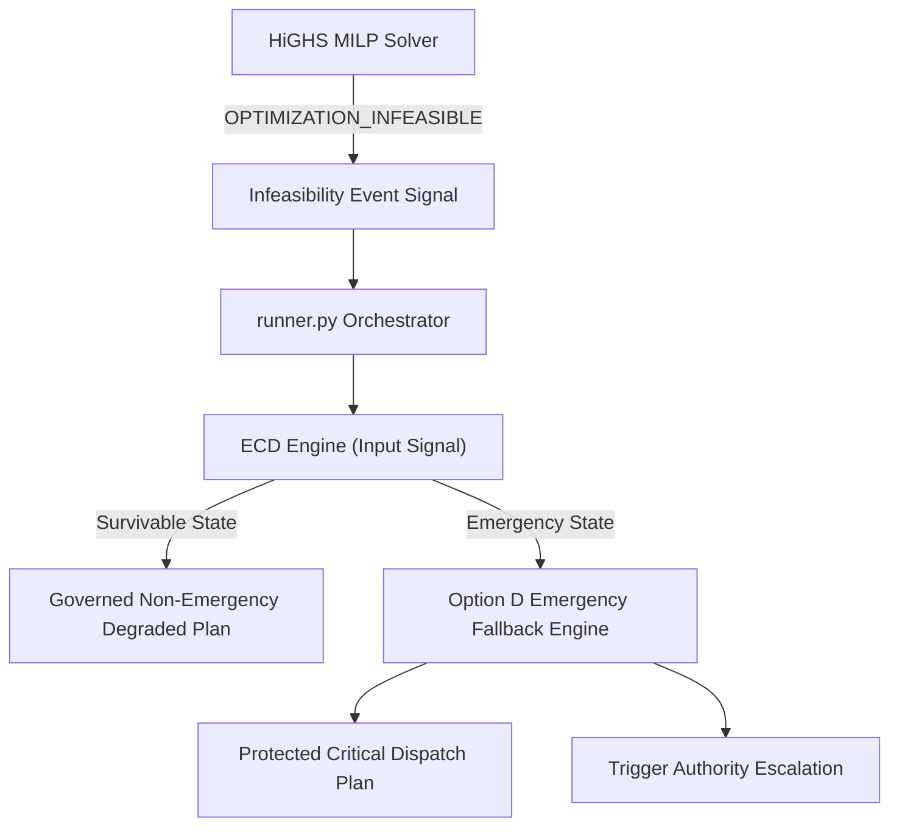

# POLARIS EMS GAP19 — MILP INFEASIBILITY ARCHITECTURE

**Gate ID**: `GAP19_OPTION_B_MULTI_SCENARIO_STRESS_TEST`  
**Package ID**: `POLARIS_EMS_GAP19_DATA_BLOCKED_OPERATIONAL_ARCHITECTURE`  

---

## 1. Rejection of Historical Zero-Dispatch Defect

The infeasibility forensic audit established:
```text
RUNTIME_INFEASIBILITY_HANDLING = DEFECT
ZERO_DISPATCH_AS_FINAL_GOVERNED_RESPONSE = REJECTED
```

The historical behavior—turning off diesel generators ($100\text{ kW}$) and dropping 100% of load (`GOVERNED_ZERO_DISPATCH`) when solver returns `kInfeasible`—is an operational handling defect that is explicitly **REJECTED**.

---

## 2. Governed Signal Routing Architecture

Under Decision D4, solver status `OPTIMIZATION_INFEASIBLE` is strictly defined as an **INPUT SIGNAL TO ECD ASSESSMENT**, NOT an automatic emergency trip, and NOT an automatic blackout.



---

## 3. Boundary Rule During Data-Blocked Conditions

While ECD production integration and Option D runtime engines are not yet deployable, `runner.py` must retain process-level containment without asserting that zero-dispatch represents safe station operation.
