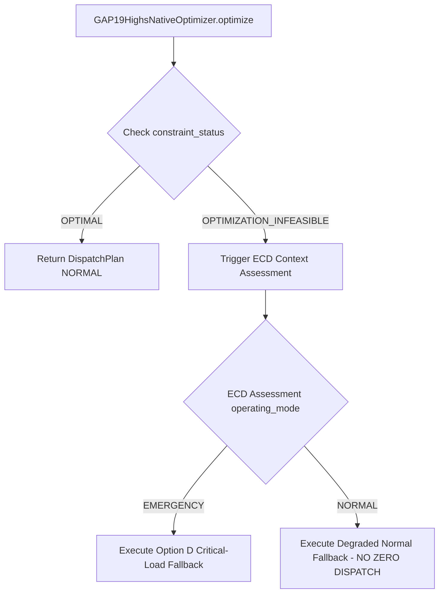

# MILP Infeasibility Interface Contract

## Governed Requirement (Decision D4)
`MILP_INFEASIBILITY = INPUT SIGNAL TO ECD ASSESSMENT PATHWAY`

## Current Solver Status Representation
In `GAP19HighsNativeOptimizer`, constraint status is returned inside `DispatchPlan.constraint_status`:
- `OPTIMAL`: Highs solver solved to optimality.
- `OPTIMIZATION_INFEASIBLE`: Solver returned infeasible.

## Adapter Interface & Flow Sequence

---

## Verdict
`MILP_INFEASIBILITY_INTERFACE = SPECIFIED`. Historical zero-dispatch response (`GOVERNED_ZERO_DISPATCH`) is explicitly rejected.
