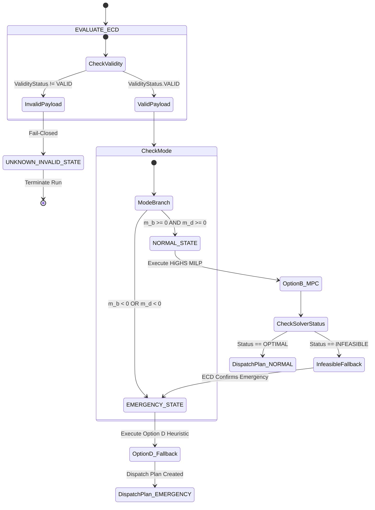

# EMS Control Router State Machine Specification

## Architecture: `EMSControlRouter` (`system/control/router.py`)

The `EMSControlRouter` operates as a pure policy routing layer wrapping ECD and optimizers:

---

## Verdict
`ROUTER_ARCHITECTURE = SPECIFIED`. Pure policy state machine without internal optimizer modifications.
