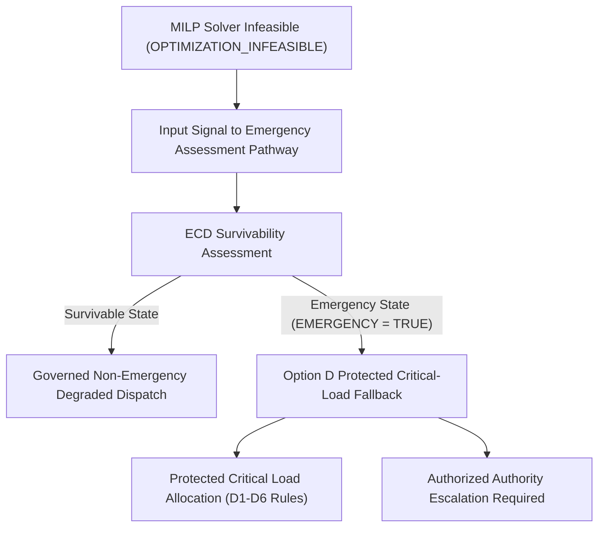

# POLARIS EMS GAP19 — MILP INFEASIBILITY HANDLING CONTRACT

**Gate ID**: `GAP19_OPTION_B_MULTI_SCENARIO_STRESS_TEST`  
**Package ID**: `POLARIS_EMS_GAP19_INFEASIBILITY_DECISION_SEAL`  
**Contract Status**: `SEALED_GOVERNANCE_CONTRACT`  

---

## 1. Governance Directive (Decision D4)

When `gap19_highs_native.py` returns `HighsModelStatus != kOptimal` (`OPTIMIZATION_INFEASIBLE`), the solver status itself **MUST NOT** be treated as the emergency detector.

The current runtime behavior in `runner.py`—returning a zero-dispatch plan (`GOVERNED_ZERO_DISPATCH`) that shuts down diesel and renewables—is explicitly **REJECTED** as final governed behavior.

---

## 2. Governed Conceptual Routing Chain

---

## 3. Implementation Rules & Contract Constraints

1. **Solver Infeasibility is Information, Not Authority**: Solver status `OPTIMIZATION_INFEASIBLE` is passed to the orchestration layer as an informational signal. It does not possess authority to unilaterally alter system operating mode.
2. **Rejection of Zero-Dispatch Blackout**: The system must not shut down active generators ($100\text{ kW}$ diesel capacity) or drop 100% of load simply because a MILP reserve slack bound failed to solve.
3. **No Replacement Implementation Authorized**: Replacing the zero-dispatch fallback in `runner.py` requires resolving runtime interfaces (ENG-03, ENG-04) and obtaining explicit human implementation authorization.
