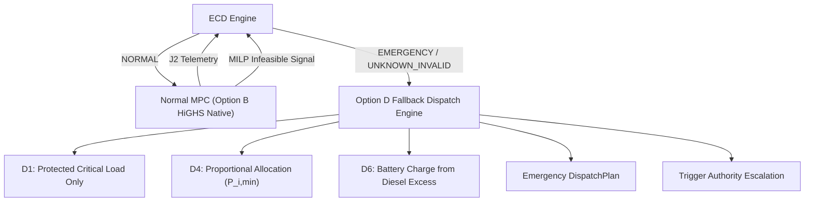

# POLARIS EMS GAP19 — OPTION D ROUTING BOUNDARY

**Gate ID**: `GAP19_OPTION_B_MULTI_SCENARIO_STRESS_TEST`  
**Package ID**: `POLARIS_EMS_GAP19_INFEASIBILITY_DECISION_SEAL`  
**Contract Status**: `SEALED_GOVERNANCE_CONTRACT`  

---

## 1. Option D Sealed Policy Baseline

Option D (**Protected Critical-Load Fallback**, DEC-004) is human-selected and sealed:
* When ECD evaluates system state as `EMERGENCY` or `UNKNOWN_INVALID`, non-critical loads are shed, and available power (diesel, renewables, battery) is allocated strictly to protected critical load ($P_{\text{critical}}(t)$).
* Under insufficient power (Clause D4), available critical power is allocated proportionally based on minimum viable requirements ($P_{i,\min}$).

---

## 2. Interface Boundary with Optimization & Control

---

## 3. Boundary Rules & Implementation Constraints

1. **Option D Trigger Constraint**: Option D is invoked **ONLY** when ECD returns `EMERGENCY` or `UNKNOWN_INVALID`. It cannot be triggered directly by MILP solver status.
2. **Dispatch Plan Representation**: In emergency mode, Option D constructs an emergency `DispatchPlan` where `load_served` is restricted to $P_{\text{critical}}(t)$ and `flexible_load_schedule = 0`.
3. **Runtime Status**: Option D runtime execution is **NOT IMPLEMENTED** and **NOT AUTHORIZED** for execution during this gate.
