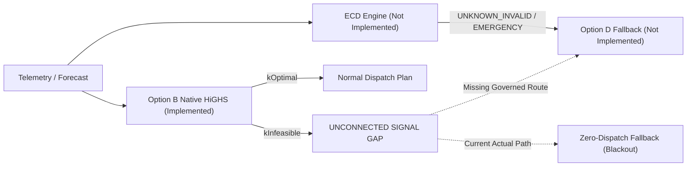

# POLARIS EMS GAP19 — ECD / MILP RELATIONSHIP AUDIT

**Gate ID**: `GAP19_OPTION_B_MULTI_SCENARIO_STRESS_TEST`  
**Classification**: `GOVERNANCE_REQUIRED`  

---

## 1. Context & Component Boundaries

The relationship between the **Emergency Condition Detector (ECD)**, **MILP Optimization**, **MILP Infeasibility**, **Emergency Mode**, and **Option D Fallback** represents a key architectural boundary in POLARIS EMS.

---

## 2. 5-Component Architectural Boundary Matrix

| System Component / Signal | Governance Status | Implementation Status | Execution Status | Operational Role |
| :--- | :--- | :--- | :--- | :--- |
| **1. ECD Survivability Assessment** | `GOVERNED` (DEC-004) | `NOT_IMPLEMENTED` | `NOT_EXECUTED` | Upstream telemetry monitor measuring survivability window $T_{\text{required}}$ to output system state (`NORMAL`, `EMERGENCY`, `UNKNOWN_INVALID`). |
| **2. MILP Optimization** | `GOVERNED` (Option B) | `IMPLEMENTED` (`gap19_highs_native.py`) | `EXECUTED_OFFLINE` | 24-hour receding-horizon optimal dispatch calculator enforcing lexicographic hierarchy $J1 \succ J2 \succ J3 \succ J4$. |
| **3. MILP Infeasibility Signal** | `IMPLEMENTATION_FACT` | `IMPLEMENTED` | `EXPOSED_IN_RUNTIME` | Downstream solver status (`kInfeasible`) returned when constraint matrix rows cannot be satisfied. Currently un-connected to ECD. |
| **4. Emergency Mode** | `GOVERNED` (DEC-004) | `SCHEMAS_EXIST` (`StationState`) | `NOT_ACTIVATED` | System operating mode where non-critical loads are shed and dispatch is restricted to protected critical load ($P_{\text{critical}}$). |
| **5. Option D Fallback** | `SELECTED_AND_SEALED` | `NOT_IMPLEMENTED` | `NOT_EXECUTED` | Authoritative governed policy response (D1–D6) when system enters emergency condition or ECD returns `UNKNOWN_INVALID`. |

---

## 3. Signal Flow & Architectural Gaps

---

## 4. Audit Verdict & Status

`ECD_RELATIONSHIP = GOVERNANCE_REQUIRED`

Human governance must explicitly resolve whether MILP solver infeasibility should be routed to ECD as a degraded health signal or directly trigger Option D fallback dispatch.
