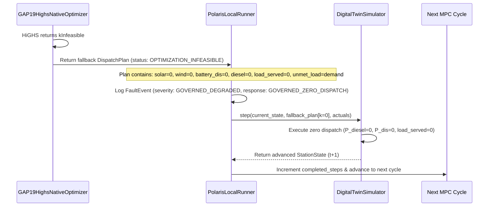

# POLARIS EMS GAP19 — RUNTIME INFEASIBILITY ARCHITECTURE AUDIT

**Gate ID**: `GAP19_OPTION_B_MULTI_SCENARIO_STRESS_TEST`  
**Classification**: `RUNTIME_INFEASIBILITY_HANDLING_DEFECT`  

---

## 1. End-to-End Execution Trace

When `HighsModelStatus != kOptimal` occurs in `gap19_highs_native.py`:

---

## 2. Granular Architectural Audit Questions & Findings

| Audit Question | Evidence & Finding | Compatibility & Safety Assessment |
| :--- | :--- | :--- |
| **1. What does fallback plan contain?** | `solar_used=0`, `wind_used=0`, `battery_charge=0`, `battery_discharge=0`, `diesel_power=0`, `load_served=0`, `unmet_load=demand`, $J1=10^9$. | **COMPLETE ZERO DISPATCH** |
| **2. Is it a feasible physical dispatch?** | **YES**. Idle battery ($P=0$) and idle diesel ($P=0$) strictly obey physical component operating bounds. | **PHYSICALLY VALID** |
| **3. Is it a governed safe state?** | **NO**. Intentionally turning off $100\text{ kW}$ of available diesel generation and dropping 100% of critical load when power is available violates life-safety protection. | **OPERATIONAL HAZARD** |
| **4. Does the Digital Twin advance?** | **YES**. `simulator.step(...)` consumes $k=0$ zero dispatch, updates last observed demand/renewables, and returns `StationState` at $t+1$. | **STATE ADVANCED** |
| **5. Is load served?** | **NO**. $0.0\text{ W}$ served; 100% of demand is dropped ($W_{\text{unmet}} = \text{demand}$). | **TOTAL BLACKOUT** |
| **6. How does runner mark the cycle?** | Logged as `FaultEvent` (`GOVERNED_DEGRADED`), but `completed_steps` increments and top-level runner reports `SUCCESS_CLEAN`. | **REPORTING MASKING** |
| **7. Is behavior compatible with D4-C1?** | Process-level exception containment (D4-C1) is satisfied (no Python crash), but functional power protection fails. | **PARTIAL COMPATIBILITY** |

---

## 3. Audit Verdict

`RUNTIME_INFEASIBILITY_HANDLING = RUNTIME_INFEASIBILITY_HANDLING_DEFECT`

*(Cascading MILP reserve slack infeasibility into zero-dispatch total load shedding is an operational handling defect that requires governed fallback routing).*
