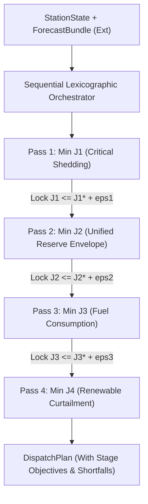

# Implementation Impact & Existing J2 Redesign Assessment

## 1. Audit of Existing J2 Implementation

The active EMS optimizer implementation is located at:
`system/optimization/implementations/milp.py` (`LocalMILPEnergyOptimizer`).

Static code review of `milp.py` reveals the following structural characteristics:

```python
# Composite Cost Objective Construction in milp.py (lines 107-114)
c[base + 2] = curt_penalty_per_wh * dt * w_t  # p_curt_sol
c[base + 3] = curt_penalty_per_wh * dt * w_t  # p_curt_wind
c[base + 4] = deg_penalty * dt * w_t         # p_chg
c[base + 5] = deg_penalty * dt * w_t         # p_dis
c[base + 7] = fuel_cost_per_l * marg_fuel_l_wh * dt * w_t  # p_diesel
c[base + 9] = unmet_penalty_per_wh * dt       # p_unmet
c[base + 13] = fuel_cost_per_l * base_fuel_l_h * dt * w_t  # u_diesel
c[base + 14] = startup_cost * w_t             # v_start
```

### Key Technical Deficiencies of Existing Implementation Relative to Governed J2 Semantics:

1. **Composite Weighted Cost Structure**: `milp.py` combines all objectives into a single 1D cost vector `c`. It does NOT implement the 4-stage lexicographic optimization hierarchy mandated by governance.
2. **Missing Stage 2 Decision Variables**: There are no decision variables for EBR shortfall $s_{\text{EBR}}[t]$, terminal shortfall $s_{\text{term}}$, or unified Stage 2 shortfall $s_{J2}[t]$.
3. **Missing EBR Lookahead Constraints**: There are no 6-hour lookahead window constraints $E[t+1] \ge E_{\text{EBR,target}}[t] + E_{\text{min}}$ in the constraint matrix.
4. **Missing Terminal Viability Constraint**: There is no boundary constraint enforcing $E[24] \ge E_{\text{term,target}} + E_{\text{min}}$.
5. **No Double-Counting Protection**: Because reserve shortfall variables are missing entirely, any attempt to patch reserve penalties into the current composite vector without structural redesign will cause severe double-counting or matrix ill-conditioning.

---

## 2. Redesign Verdict

```text
EXISTING_J2_IMPLEMENTATION = REDESIGN_REQUIRED
RETAIN_AS_IS = REJECTED
MINOR_MODIFICATION = REJECTED
```

### Rationale:
- **Retain As-Is**: `REJECTED`. The current implementation lacks the fundamental variables, constraints, and objective hierarchy specified by governed J2 semantics.
- **Minor Modification**: `REJECTED`. Adding reserve penalties to the single composite cost vector $c$ maintains Option C (weighted scalarization), which suffers from weight scale separation and fails to guarantee lexicographic priority.
- **Redesign Required**: `APPROVED`. The optimizer MUST be redesigned to support **Option A (Sequential Lexicographic MILP Orchestrator)** or **Option B (Solver-Native Multi-Objective API)** with an expanded $K=17$ decision variable vector per timestep.

---

## 3. Redesign Architectural Roadmap



1. **Phase 1 (Schemas)**: Implement additive fields for `ForecastBundle`, `StationState`, and `DispatchPlan`.
2. **Phase 2 (Variable & Matrix Engine)**: Build the $K=17$ MILP matrix generator supporting Stage 1-4 cost vectors and lock constraints.
3. **Phase 3 (Orchestration Engine)**: Implement `SequentialLexicographicMILPOptimizer` wrapping SciPy HiGHS `milp()` calls.
4. **Phase 4 (Validation Suite)**: Execute static and single-cycle tests once governance grants implementation authorization.
