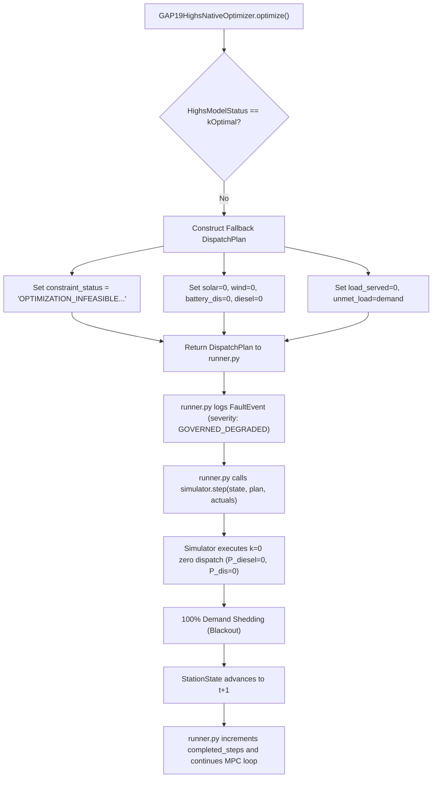

# POLARIS EMS GAP19 — RUNTIME INFEASIBILITY HANDLING AUDIT

**Gate ID**: `GAP19_OPTION_B_MULTI_SCENARIO_STRESS_TEST`  
**Classification**: `RUNTIME_INFEASIBILITY_HANDLING_DEFECT`  

---

## 1. Trace of Infeasible Solver Execution Path

When `h.getModelStatus() != HighsModelStatus.kOptimal` occurs in `gap19_highs_native.py`:

---

## 2. Detailed Forensic Audit Questions & Empirical Answers

### Q1: Does an infeasible solver result produce a valid DispatchPlan?
* **YES**. `gap19_highs_native.py` catches non-optimal status and returns a syntactically valid `DispatchPlan` object with:
  * `constraint_status = "OPTIMIZATION_INFEASIBLE: HighsModelStatus.kInfeasible"`

### Q2: What exact values are contained in that fallback plan?
* `solar_used`: `[0.0] * 24`
* `wind_used`: `[0.0] * 24`
* `battery_charge`: `[0.0] * 24`
* `battery_discharge`: `[0.0] * 24`
* `battery_soc`: `[20.0] * 24` ($SOC_{\min}$)
* `diesel_power`: `[0.0] * 24`
* `load_served`: `[0.0] * 24`
* `renewable_curtailment`: `[solar + wind] * 24`
* `unmet_load`: `demand` ($100\%$ unmet demand)
* Objectives: $J1 = 10^9, J2 = 10^9, J3 = 10^9, J4 = 10^9$

### Q3: Does `runner.py` execute it? Does the simulator execute it?
* **YES**. `runner.py` receives the fallback plan, logs a `FaultEvent` (`severity: GOVERNED_DEGRADED`, `response: GOVERNED_ZERO_DISPATCH`), and passes $k=0$ to `simulator.step(...)`.
* The simulator executes $k=0$: `battery_charge=0`, `battery_discharge=0`, `diesel_power=0`.

### Q4: Does `StationState` advance? Is the resulting state physically meaningful?
* **YES**. `StationState` advances to $t+1$.
* **Operational Hazard Identified**: The physical state is valid (idle battery, idle diesel), but the station **dropped 100% of critical load** despite having $100\text{ kW}$ of diesel capacity and $35\text{ kW}$ of wind capacity available! Because the solver reported infeasibility on a reserve slack upper bound, the system shut down all power generation and caused a total station blackout.

### Q5: Is the cycle marked successful, degraded, or failed?
* `runner.py` logs `FaultEvent` as `GOVERNED_DEGRADED`, increments `completed_steps`, and maintains `execution_status = "SUCCESS_CLEAN"`.
* Thus, top-level runner execution treats solver infeasibility as a **completed degraded step**, not a pipeline breakdown.

### Q6: Is the behavior consistent with D4-C1 failure containment?
* Process-level containment (not throwing an unhandled exception) is consistent with D4-C1.
* However, **cascading a reserve slack constraint infeasibility into 100% load shedding without attempting emergency diesel dispatch is an operational handling defect**.

---

## 3. Audit Verdict

`RUNTIME_INFEASIBILITY_HANDLING = RUNTIME_INFEASIBILITY_HANDLING_DEFECT`

*(Current runtime fallback forces total load shedding when MILP reserve constraints fail, ignoring available diesel generation).*
