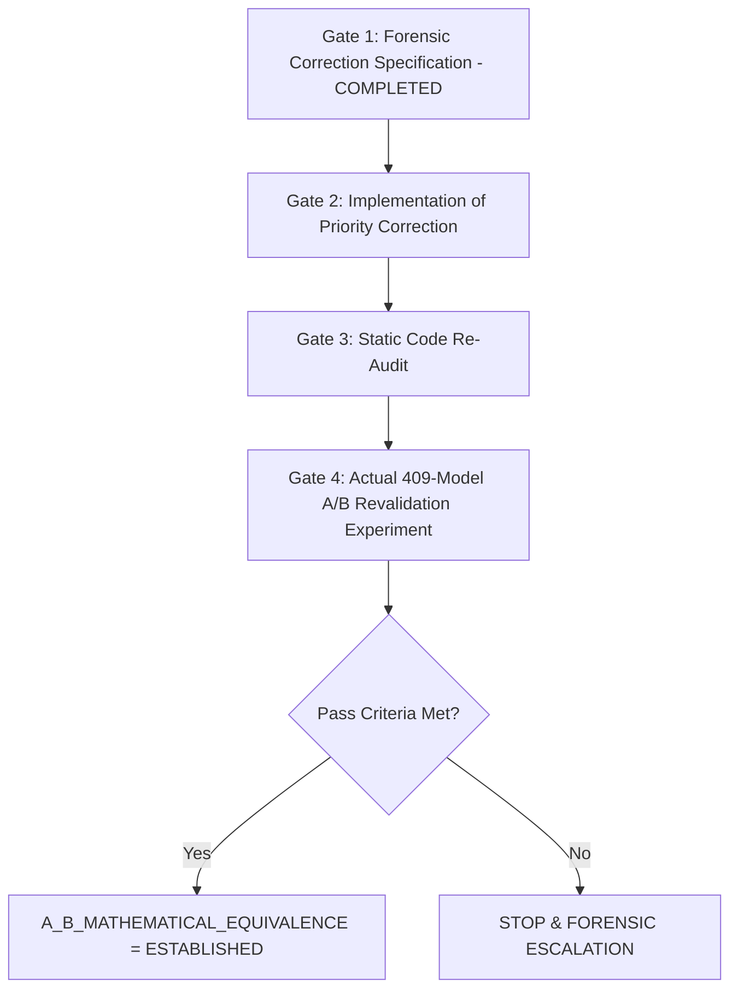

# Post-Correction Revalidation Plan

Following the completion of this forensic analysis gate, the revalidation workflow must follow a strict 3-phase sequence:

## Revalidation Verification Criteria

1. **Objective Equivalence**: $dJ_1 = 0.0$, $dJ_2 = 0.0$, $dJ_3 \le 10^{-6}\text{ L}$, $dJ_4 = 0.0$ across all test regimes.
2. **Constraint Residuals**: Maximum constraint violation $< 10^{-6}$.
3. **Reproducibility**: 100% deterministic results across repeated runs.
