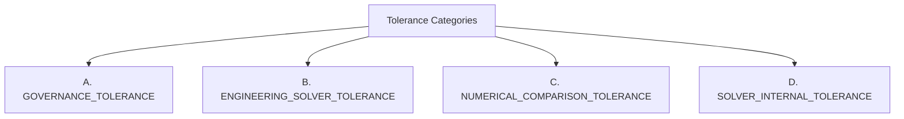

# TOLERANCE TAXONOMY

## Canonical Four-Tier Tolerance Taxonomy

This document establishes the canonical taxonomy separating four distinct tolerance concepts in POLARIS EMS optimization.

---

## Canonical Tolerance Taxonomy

### A. GOVERNANCE TOLERANCE
- **Definition**: A numerical tolerance scalar explicitly authorized by human governance as part of POLARIS EMS objective policy.
- **Current Status**: `NOT_ESTABLISHED`.
- **Usage**: Governed policy boundaries ($\varepsilon_k$ locks).

### B. ENGINEERING SOLVER TOLERANCE
- **Definition**: A tolerance parameter required to configure solver algorithms in code (e.g. `abs_tolerance`, `rel_tolerance` passed to `HighsLinearObjective`).
- **Current Status**: `REQUIRES_ENGINEERING_DEFINITION`.
- **Usage**: Solver configuration.

### C. NUMERICAL COMPARISON TOLERANCE
- **Definition**: A threshold scalar ($\varepsilon_x$) used exclusively when comparing floating-point decision vectors or objective values between two software implementations.
- **Current Status**: `TEST_SPECIFICATION_REQUIRED` (`PROVISIONAL_TEST_THRESHOLD = 1e-5`).
- **Usage**: Equivalence test evaluation only.

### D. SOLVER-INTERNAL TOLERANCE
- **Definition**: Internal numerical tolerances maintained by the HiGHS C++ engine (`mip_feasibility_tolerance`, primal/dual feasibility limits).
- **Current Status**: `SOLVER_DEPENDENT` (Defaults: `1e-4` MIP rel tol, `1e-7` primal tol).
- **Usage**: C++ solver algorithm convergence.

---

## Rule

These four categories MUST NEVER be conflated. An engineering test threshold ($10^{-5}$) or solver default is NEVER a governance tolerance.
