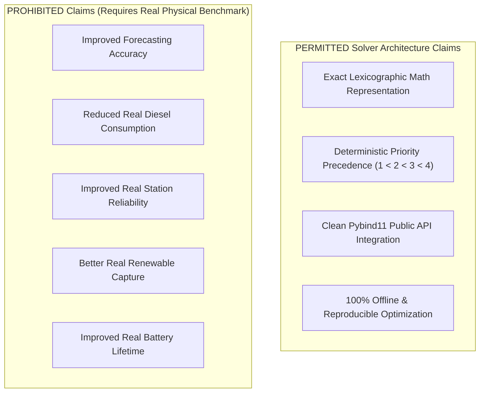

# SCIENTIFIC CLAIM BOUNDARY

## Authoritative Boundary Governing Solver Architecture Claims

This document defines the strict boundary isolating solver architecture selection from real-world physical performance claims.

---

## Authoritative Claim Boundaries

---

## Technical Statement

> [!IMPORTANT]
> Native HiGHS multi-objective optimization establishes a **solver optimization mechanism**, NOT a claim of improved forecasting accuracy or real-world energy performance.
> Claims regarding fuel savings, battery life extension, or station survivability MUST NOT be made until controlled POLARIS closed-loop benchmark experiments are executed post-implementation authorization.
