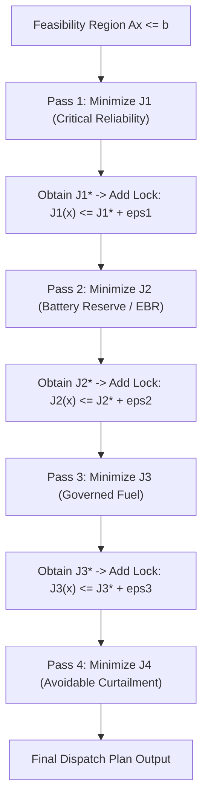

# OPTION A DEFINITION

## POLARIS-Controlled Sequential Lexicographic MILP Solves

This document provides the formal technical specification for **Option A**.

---

## Architectural Overview

In **Option A**, POLARIS manages the lexicographic multi-objective optimization process explicitly within Python control logic. The EMS executes a sequence of single-objective MILP solves using SciPy's public `scipy.optimize.milp` API.

After each stage solve, POLARIS records the optimal objective value $J_k^*$, constructs a linear lock constraint $J_k(x) \le J_k^* + \varepsilon_k$, appends this lock to the problem constraint matrix, and proceeds to optimize the next priority objective.

---

## Technical Characteristics

1. **Solver API**: Public `scipy.optimize.milp` function.
2. **Number of Solver Calls**: Exactly 4 solver calls per MPC timestep $t$.
3. **Lock Mechanism**: Explicit linear inequality constraints added to constraint matrix $A \cdot x \le b$.
4. **Tolerance Controls**: Lock tolerance $\varepsilon_k$ (absolute or relative) managed explicitly by POLARIS logic between passes.
5. **Dependencies**: Uses standard SciPy public API. Requires zero internal private SciPy imports and zero external `highspy` C++ wrapper dependencies.
6. **Environment Compatibility**: 100% compatible out-of-the-box in the currently installed environment.
