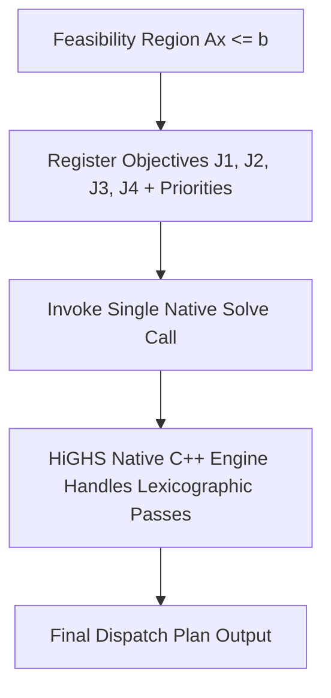

# OPTION B DEFINITION

## Solver-Native Multi-Objective / Lexicographic Optimization

This document provides the formal technical specification for **Option B**.

---

## Architectural Overview

In **Option B**, multi-objective lexicographic optimization is offloaded to the internal C++ engine of the HiGHS solver. POLARIS constructs the system feasibility constraints once, registers all four objective vectors $(J_1, J_2, J_3, J_4)$ with their assigned priority indices, objective weights, and tolerance limits, and invokes a single native solver execution.

The solver engine manages the lexicographic sequence, basis re-use, and internal lock constraints natively within C++.

---

## Technical Characteristics

1. **Solver API**: Solver-native multi-objective C++ API (via `highspy` or private SciPy C++ wrappers).
2. **Number of Solver Calls**: Single Python solver function call per MPC timestep $t$.
3. **Lock Mechanism**: Managed internally by HiGHS C++ engine during multi-objective solve.
4. **Tolerance Controls**: Native absolute and relative objective tolerances (`abs_tolerance`, `rel_tolerance`) passed to solver objective structures.
5. **Dependencies**: Requires either the standalone `highspy` Python package or private internal SciPy C++ wrappers (`scipy.optimize._highs`).
6. **Environment Compatibility**: SciPy's public `milp()` does **NOT** expose multi-objective parameters. Option B cannot be executed via `scipy.optimize.milp` without private API extensions or installing `highspy`.
