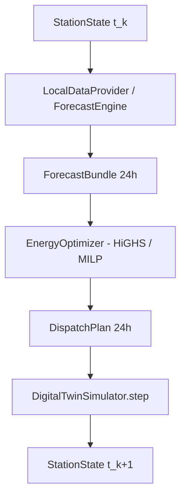
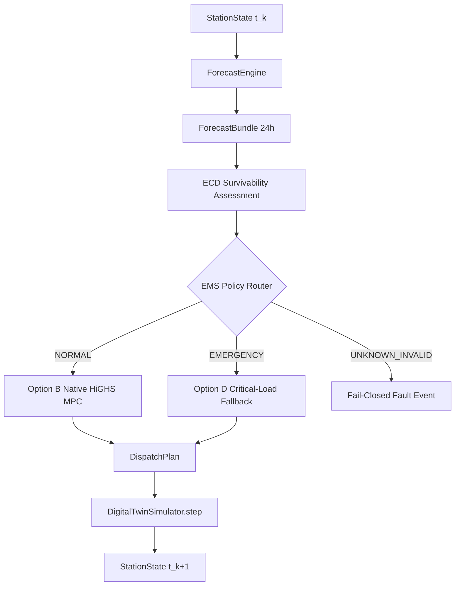

# Current Runtime Control Flow & Proposed Architecture Audit

## 1. Actual Implemented Runtime Control Flow
Inspection of `system/runtime/runner.py` (`PolarisLocalRunner.run_pipeline`) reveals the following sequence per timestep $k$:

### Control Edge Classifications:
1. `StationState` $	o$ `ForecastEngine`: `ESTABLISHED_RUNTIME`
2. `ForecastEngine` $	o$ `ForecastBundle`: `ESTABLISHED_RUNTIME`
3. `ForecastBundle` $	o$ `EnergyOptimizer` (HiGHS / MILP): `ESTABLISHED_RUNTIME`
4. `EnergyOptimizer` $	o$ `DispatchPlan`: `ESTABLISHED_RUNTIME`
5. `DispatchPlan` $	o$ `DigitalTwinSimulator`: `ESTABLISHED_RUNTIME`
6. `DigitalTwinSimulator` $	o$ `StationState`: `ESTABLISHED_RUNTIME`

---

## 2. Proposed Target Control Flow with ECD & Option D
To incorporate ECD emergency authority and Option D fallback without altering Option B MPC semantics, the proposed control flow sits as an EMS Policy Router around the optimizer:

### Edge Classifications for Proposed Architecture:
1. `ForecastBundle` + `StationState` $	o$ `ECD Survivability Assessment`: `PROPOSED_ARCHITECTURE`
2. `ECD Survivability Assessment` $	o$ `EMS Policy Router`: `PROPOSED_ARCHITECTURE`
3. `EMS Policy Router (NORMAL)` $	o$ `Option B MPC`: `PROPOSED_ARCHITECTURE`
4. `EMS Policy Router (EMERGENCY)` $	o$ `Option D Fallback`: `NOT_IMPLEMENTED`
5. `EMS Policy Router (UNKNOWN_INVALID)` $	o$ `Fail-Closed Handling`: `NOT_IMPLEMENTED`
