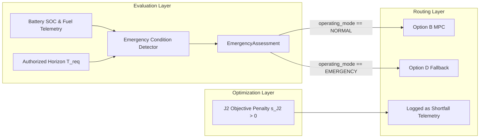

# J2 Reserve Shortfall vs ECD Emergency Authority Signal Separation Audit

## Governance Mandate (Decisions D1 & D3)
1. **Decision D1**: J2 Emergency Reserve semantics are **`HYBRID / MODE-DEPENDENT`**. J2 represents emergency battery reserve shortfall penalty inside normal MPC optimization.
2. **Decision D3**: **ECD is the SOLE EMERGENCY AUTHORITY**. J2 shortfall does **NOT** independently declare emergency.

## Signal Flow Architecture

## Architectural Guarantee
- If $s_{J2} > 0$ occurs during Option B HiGHS optimization, the system records `reserve_shortfall > 0` in `DispatchPlan`.
- However, the EMS mode router checks `EmergencyAssessment.operating_mode`. As long as $m_{\text{battery}} \ge 0$ and $m_{\text{diesel}} \ge 0$, `operating_mode` remains **`NORMAL`**.
- The system will **NEVER** bypass ECD authority or force `EMERGENCY` mode merely because $s_{J2} > 0$.
