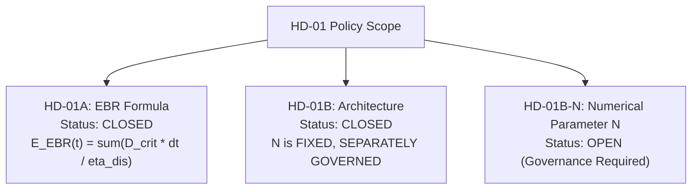

# POLARIS EMS — HD-01B-N Governance Gap Report

**Audit Objective**: Define the minimum unresolved governance decisions required to select a numerical value for the EBR resilience interval $N$.

---

## 1. Decision Status Summary



---

## 2. Unresolved Governance Gaps for HD-01B-N

### GAP-HD01B-N-1: Numerical Interval Selection
- **Description**: Select the quantitative resilience hours $N \in \{2, 4, 6, 8, 12, 18, 24\}$.
- **Impact**: Sets the summation window length for $E_{\text{EBR\_target}}(t)$ at each timestep $t$ in the optimizer.
- **Required Action**: Human Governance Decision.

### GAP-HD01B-N-2: Critical Load Profile Authorization
- **Description**: Authorize a station-measured or governed critical load trajectory $D_{\text{critical}}(k)$ to replace the synthetic baseline ($30\text{ kW}$) in `loads.yaml`.
- **Impact**: Enables accurate computation of $E_{\text{EBR\_target}}(t)$ in Wh.
- **Required Action**: Station Engineering Data Provision.

---

## 3. Implementation Authorization Block

```plain
HD01B_N_IMPLEMENTATION_AUTHORIZATION=NOT_GRANTED
HD01B_N_EXECUTION_AUTHORIZATION=NOT_GRANTED
HD01B_N_NUMERICAL_VALUE=GOVERNANCE_DECISION_REQUIRED
```
