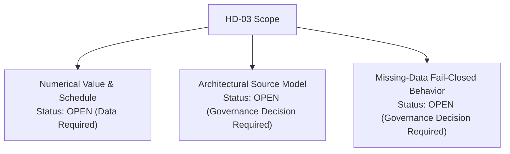

# POLARIS EMS — HD-03 Architectural Governance Gap Report

**Audit Objective**: Identify the precise remaining architectural decisions and governance gaps needed to complete the $T_{\text{required}}$ representation.

---

## 1. Decision Status Summary



---

## 2. Unresolved Architectural Governance Gaps for HD-03

### GAP-HD03-ARCH-1: Source Model Selection
- **Description**: Select Option A (Operational Input), Option B (Fixed Governed Parameter), Option C (Configurable Parameter), or Dual-Model (Option C Default + Option A Override).
- **Required Action**: Stakeholder Governance Decision.

### GAP-HD03-ARCH-2: Missing-Input Fail-Closed Policy
- **Description**: Define system behavior when $T_{\text{required}}$ is omitted at startup.
- **Candidates**:
  - Fail-Closed: System aborts boot / refuses to run Emergency Mode Detector.
  - Governed Fallback: System uses authorized fallback value (e.g. 48h) and emits high-priority telemetry alert.
- **Required Action**: Stakeholder Governance Decision (`HD03_MISSING_INPUT_BEHAVIOR = GOVERNANCE_REQUIRED`).

### GAP-HD03-ARCH-3: Schema Update Authorization
- **Description**: Authorize schema additions in `StationState` or `config` to house $T_{\text{required}}$.
- **Required Action**: Engineering & Governance Authorization (`HD03_IMPLEMENTATION_AUTHORIZATION = NOT_GRANTED`).

---

## 3. Implementation Authorization Block

```plain
HD03_NUMERICAL_VALUE=NOT_ESTABLISHED
HD03_IMPLEMENTATION_AUTHORIZATION=NOT_GRANTED
HD03_EXECUTION_AUTHORIZATION=NOT_GRANTED
```
