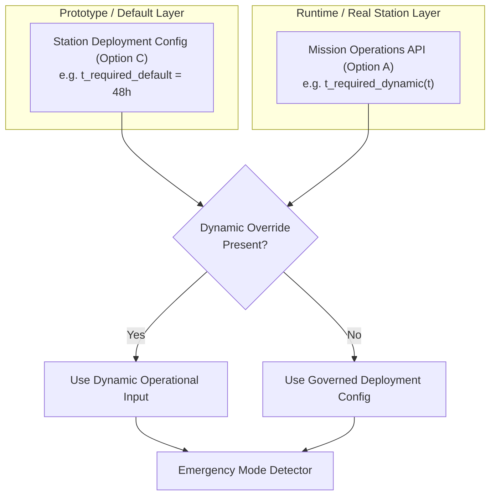

# POLARIS EMS — HD-03 Architecture Source Evidence Map

**Audit Scope**: Detailed traceability map of schema files, state interfaces, and configuration entry points for $T_{\text{required}}$.

---

## 1. Traceability & Inspection Matrix

| Component / Interface | File Path | Line Range | Current Status | Architectural Option Impact |
| :--- | :--- | :--- | :--- | :--- |
| **StationState Schema** | [`system/state/state.py`](file:///home/punith-bs/01polaris%20%28Copy%29/system/state/state.py) | Full File | `t_required_hours` ABSENT | Option A requires adding dynamic `t_required_hours` field |
| **ForecastBundle Schema** | [`system/forecasting/bundle.py`](file:///home/punith-bs/01polaris%20%28Copy%29/system/forecasting/bundle.py) | Full File | No survival window field | Unaffected unless window varies per timestep forecast |
| **System Optimizer Config**| [`system/config/optimizer.yaml`](file:///home/punith-bs/01polaris%20%28Copy%29/system/config/optimizer.yaml) | L1-L15 | No survival window field | Option B requires adding fixed system parameter |
| **Station Config Schema** | [`system/config/battery.yaml`](file:///home/punith-bs/01polaris%20%28Copy%29/system/config/battery.yaml) | L1-L12 | Component specs only | Option C requires adding station deployment parameter |
| **Detector Interface Spec**| Detector Audit Sheet 06 | Sheet 06 | `t_required_hours` marked `ABSENT` | Detector consumes `t_required_hours` from state or config |
| **V2 Logger Telemetry** | [`system/telemetry/v2_logger.py`](file:///home/punith-bs/01polaris%20%28Copy%29/system/telemetry/v2_logger.py) | L40-L100 | No survival window field | Telemetry logger must record $T_{\text{required}}$ value and source |

---

## 2. Dual-Model Prototype vs Real-Station Architecture

### Architectural Finding
POLARIS can adopt a **dual-model architecture** where a governed station deployment configuration (Option C) provides the baseline $T_{\text{required}}$, while allowing a dynamic operational input (Option A) to override it when live mission operations data is available.
