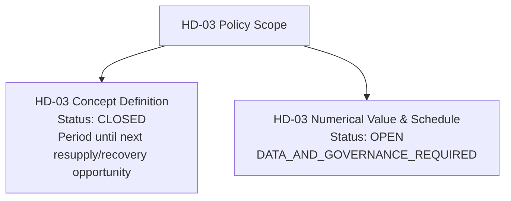
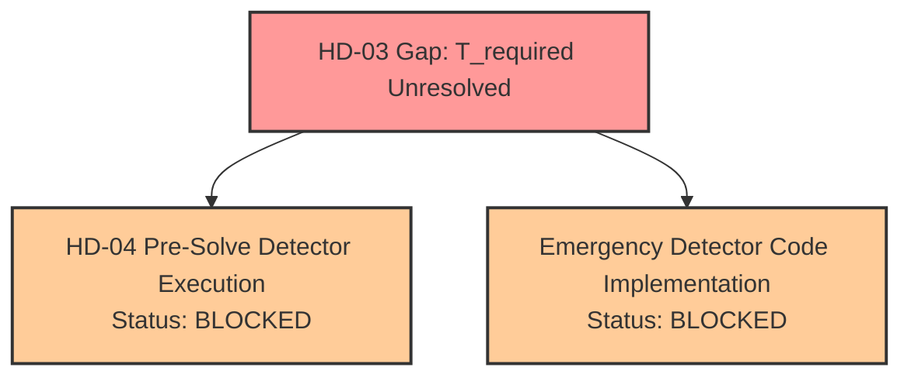

# POLARIS EMS — HD-03 Governance Gap & Operational Input Report

**Audit Objective**: Identify the precise missing operational data and governance decisions required to establish a numerical value for $T_{\text{required}}$.

---

## 1. Decision Status Summary



---

## 2. Precise Missing Operational Inputs for HD-03

To establish an authoritative numerical $T_{\text{required}}$, station operations or human governance must provide one of the following authoritative data sources:

1. **Authoritative Fuel Delivery Schedule**: A confirmed logistics contract specifying the maximum delivery interval in hours between fuel tank refuels.
2. **Authoritative Station Resupply Cadence**: A station operational schedule defining the resupply cycle duration $T_{\text{resupply}}$ (e.g., weekly, bi-weekly, monthly).
3. **Guaranteed External Recovery Lead Time**: A station mission specification defining the maximum time required for external rescue or recovery teams to arrive after an emergency event.
4. **Governed Default Survival Horizon**: A formal human stakeholder policy decision authorizing a specific default survival window (e.g. $T_{\text{required}} = 48\text{h}$ or $72\text{h}$) when resupply dates are unannounced.

---

## 3. Impact on Dependent Downstream Implementation



- **`HD-04_IMPLEMENTATION_BLOCKED_BY_HD03 = YES`**: HD-04 Option A (Zero-Renewable Baseline) is structurally closed, but the Emergency Mode Detector code cannot execute its forward endurance calculation without $T_{\text{required}}$.

---

## 4. Implementation Authorization Block

```plain
HD03_NUMERICAL_VALUE=NOT_ESTABLISHED
HD03_IMPLEMENTATION_AUTHORIZATION=NOT_GRANTED
HD03_EXECUTION_AUTHORIZATION=NOT_GRANTED
```
