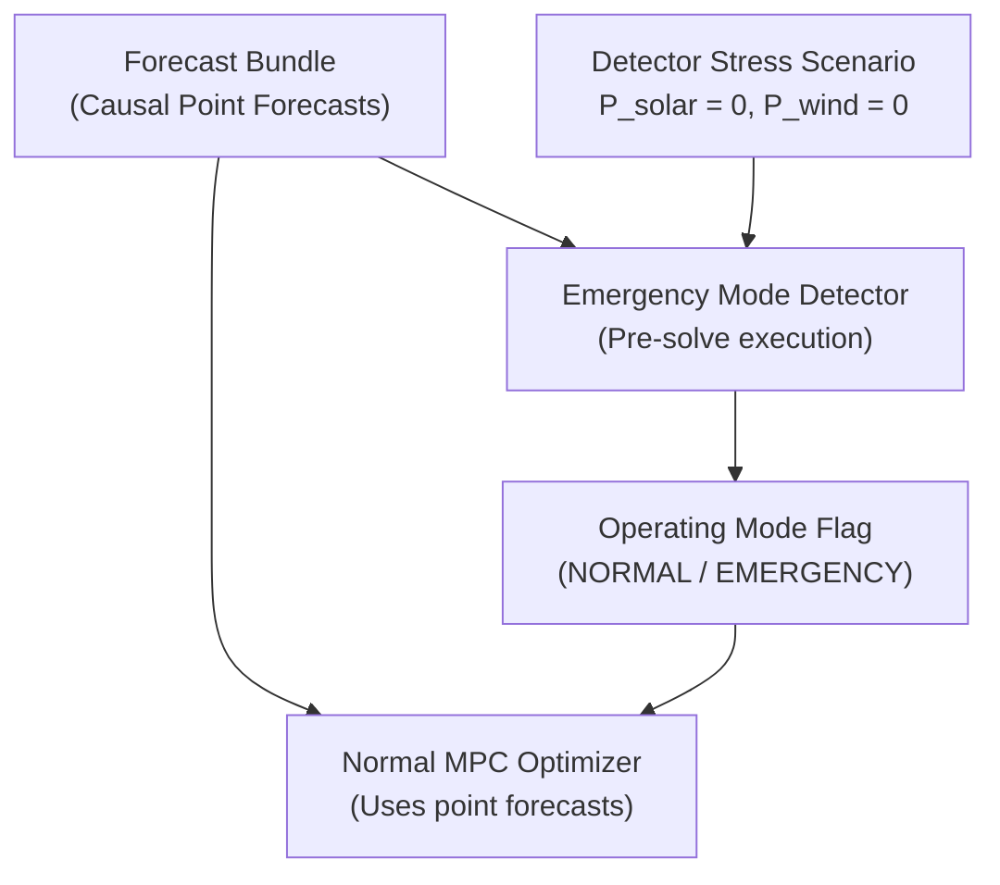

# POLARIS EMS — HD-04 Source Evidence Map

**Audit Scope**: Traceability of all HD-04 files, specifications, detector concepts, and governance records.

---

## 1. Traceability & Inspection Matrix

| Artifact / File Path | Relevant Section / Line | Existing Content / Finding | HD-04 Assessment |
| :--- | :--- | :--- | :--- |
| [`POLARIS_EMS_HD04_ADVERSE_RENEWABLE_AUDIT.md`](file:///home/punith-bs/01polaris%20%28Copy%29/POLARIS_EMS_HD04_ADVERSE_RENEWABLE_AUDIT/HD04_ADVERSE_RENEWABLE_AUDIT.md#L54) | L54, L66, L182 | Documents $P=0$ as technically valid floor; marked `OPEN` | Prior audit valid; decision required |
| [`09_HD04_HUMAN_DECISION_REGISTER.csv`](file:///home/punith-bs/01polaris%20%28Copy%29/POLARIS_EMS_HD04_ADVERSE_RENEWABLE_AUDIT/09_HD04_HUMAN_DECISION_REGISTER.csv#L3) | L3 (HD-04B) | $P=0$ is conservative floor requiring stakeholder approval | Confirms `HUMAN_DECISION_REQUIRED = YES` |
| [`POLARIS_EMS_SURVIVABILITY_DETECTOR_SPECIFICATION_AUDIT.md`](file:///home/punith-bs/01polaris%20%28Copy%29/POLARIS_EMS_SURVIVABILITY_DETECTOR_SPECIFICATION_AUDIT/SURVIVABILITY_SPECIFICATION_AUDIT.md#L145) | L145 | Detector adverse renewable assumption marked blocking for code | Confirms code implementation blocked |
| [`system/optimization/implementations/milp.py`](file:///home/punith-bs/01polaris%20%28Copy%29/system/optimization/implementations/milp.py#L68-L69) | L68-L69 | Uses point forecasts `solar_generation.point`, `wind_generation.point` | Confirms normal MPC uses causal point forecasts |

---

## 2. Structural & Architectural Verification

### Verification Findings
1. **No Forecast Contamination**: Zero renewable is restricted to the Emergency Mode Detector. Normal MPC receives standard point forecasts.
2. **Causal Integrity**: Pre-solve detector execution introduces zero circular dependencies.
3. **No Numerical Dependencies**: Option A ($P=0$) requires zero unbacked numerical parameters.
