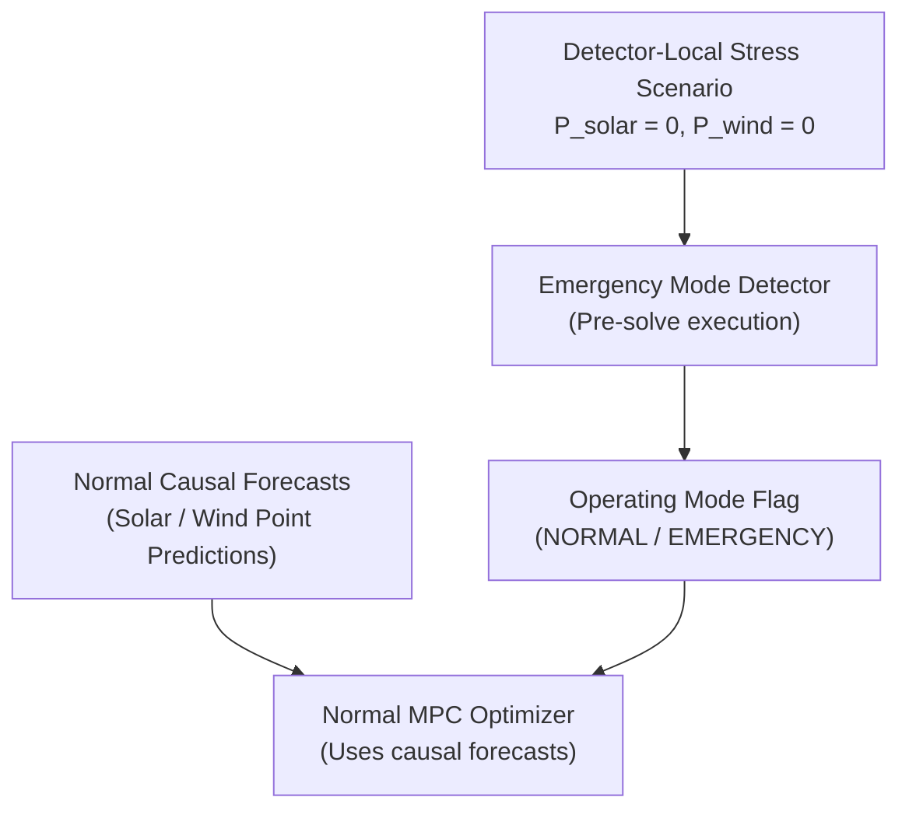

# POLARIS EMS — HD-04 Option A Zero-Renewable Emergency Survivability Baseline Governance Closure Report

**Governance Status**: CLOSED  
**Human Decision**: HD-04 Option A (Zero-Renewable Emergency Survivability Baseline)  
**Target Directory**: [`POLARIS_EMS_HD04_ZERO_RENEWABLE_CLOSURE/`](file:///home/punith-bs/01polaris%20%28Copy%29/POLARIS_EMS_HD04_ZERO_RENEWABLE_CLOSURE/)  

---

## Authoritative Policy Statement

The human stakeholder has formally selected **Option A** to close **HD-04**:

> *"The Emergency Mode Detector shall evaluate station fuel and battery survivability through $T_{\text{required}}$ assuming zero future renewable generation ($P_{\text{solar}} = 0, P_{\text{wind}} = 0$) as a detector-local stress scenario. Normal MPC optimization shall continue using standard causal forecasts without modification."*

---

## 1. Required Governance Classifications

```plain
HD04_STATUS = CLOSED
HD04_DECISION = OPTION_A_ZERO_RENEWABLE
HD04_SOLAR_SCENARIO = 0
HD04_WIND_SCENARIO = 0
HD04_SCENARIO_ROLE = DETECTOR_LOCAL_SURVIVABILITY_STRESS_SCENARIO
HD04_NORMAL_MPC_FORECAST = UNCHANGED
HD04_POLICY_BASIS = STAKEHOLDER_POLICY_DECISION
HD04_EMPIRICAL_DERIVATION = NOT_ESTABLISHED
HD04_IMPLEMENTATION_AUTHORIZATION = NOT_GRANTED
HD04_EXECUTION_AUTHORIZATION = NOT_GRANTED

CURRENT_GOVERNANCE_STATE = HD04_CLOSED
IMPLEMENTATION_STATE = NOT_AUTHORIZED
```

---

## 2. Authoritative Semantics & MPC Separation

### 2.1 Detector-Local Stress Scenario Scope
- **Detector Renewable Input**: $P_{\text{solar}} = 0, \ P_{\text{wind}} = 0$.
- **Semantic Meaning**: Emergency survivability is evaluated against a zero-renewable stress scenario to test whether battery energy and diesel fuel alone can preserve critical load through $T_{\text{required}}$.
- **Prohibited Interpretations**: Zero-renewable MUST NOT be described as expected weather, a solar/wind forecast, a prediction of actual future generation, a forecast model correction, or an operational guarantee.

### 2.2 Strict Normal MPC Isolation
Normal MPC optimization continues using standard causal renewable forecasts without modification.



The optimizer MUST NOT:
- declare its own emergency state
- modify the detector scenario
- modify detector thresholds
- manipulate its own emergency classification

---

## 3. Consistency Audit Results across Closed Decisions

| Decision / Policy ID | Governed Policy Baseline | HD-04 Interaction & Compatibility | Compatibility Status |
| :--- | :--- | :--- | :--- |
| **HD-01A (EBR Definition)** | EBR = Critical-load-based dynamic target | Detector uses $P=0$ pre-solve; EBR formula unchanged | `FULLY_COMPATIBLE` |
| **HD-01B (Resilience Window)**| $N = 6\text{ HOURS}$ normal resilience interval | $N=6\text{h}$ is normal-mode target; $P=0$ applies to $T_{\text{required}}$ in detector | `FULLY_COMPATIBLE` |
| **HD-02 (Terminal Target)** | $E_{\text{terminal\_target}} = E_{\text{EBR\_target}}(H)$ | Active during normal MPC solve; unaffected by pre-solve detector $P=0$ | `FULLY_COMPATIBLE` |
| **HD-03 ($T_{\text{required}}$ Window)** | Independent operational survival window | Detector assesses zero-renewable survival through $T_{\text{required}}$ without assigning a numerical value | `FULLY_COMPATIBLE` |
| **HD-05 (Battery Degradation)**| Normal: $F \le 1.05 F^*$; Emergency: degradation subordinate | Normal 5% slack active when detector signals `NORMAL`. Emergency subordination active when `EMERGENCY` | `FULLY_COMPATIBLE` |
| **Policy E3 (Emergency Policy)**| Preserve resource with larger survivability margin | Pre-solve detector determines if `EMERGENCY` applies; E3 governs resource trade inside emergency solve | `FULLY_COMPATIBLE` |

---

## 4. Final Hard Stop & Implementation Boundary

Formal closure of HD-04 Option A records the authoritative policy decision but **does NOT grant implementation or execution authorization**.

```plain
HD04_STATUS=CLOSED
HD04_DECISION=OPTION_A_ZERO_RENEWABLE
HD04_SOLAR_SCENARIO=0
HD04_WIND_SCENARIO=0
HD04_POLICY_BASIS=STAKEHOLDER_POLICY_DECISION
HD04_IMPLEMENTATION_AUTHORIZATION=NOT_GRANTED
HD04_EXECUTION_AUTHORIZATION=NOT_GRANTED
CURRENT_GOVERNANCE_STATE=HD04_CLOSED
IMPLEMENTATION_STATE=NOT_AUTHORIZED
```
