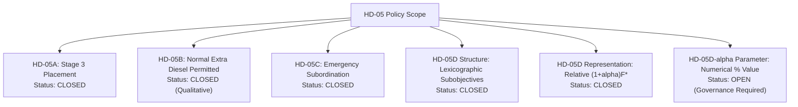

# POLARIS EMS — HD-05D-α Governance Gap Report

**Audit Objective**: Define the minimum unresolved governance decisions required to close the relative extra-fuel tolerance parameter $\alpha$.

---

## 1. Governance Decision Status Summary



---

## 2. Unresolved Governance Gaps for HD-05D-α

### GAP-HD05D-α-1: Numerical Percentage Selection
- **Description**: Select the quantitative percentage fraction $\alpha \in (0, 1)$ for normal operation.
- **Example Candidate Ranges** (for stakeholder evaluation only): $\alpha = 0.01 \ (1\%), 0.02 \ (2\%), 0.05 \ (5\%)$.
- **Impact**: Sets the maximum allowable fuel increase in Stage 3b to save battery cycling.
- **Required Action**: Human Governance Decision.

### GAP-HD05D-α-2: Zero-Fuel Day Exception Rule
- **Description**: Confirm whether the natural mathematical behavior ($F^* = 0 \implies F_{\text{diesel}} \le 0$) holds, or whether a zero-fuel exception floor is required.
- **Impact**: Prevents generator startup when 100% renewable self-sufficiency is achieved.
- **Required Action**: Human Governance Clarification.

---

## 3. Implementation Authorization Block

```plain
HD05D_ALPHA_IMPLEMENTATION_AUTHORIZATION=NOT_GRANTED
HD05D_ALPHA_EXECUTION_AUTHORIZATION=NOT_GRANTED
HD05D_ALPHA_NUMERICAL_VALUE=GOVERNANCE_DECISION_REQUIRED
```
