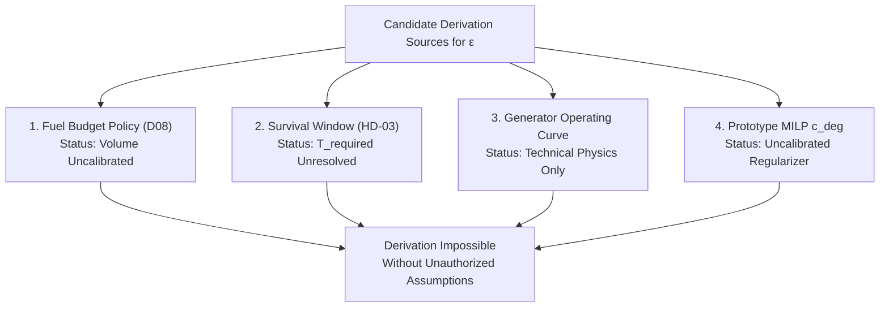

# POLARIS EMS — HD-05D-ε Derivation & Representation Audit

**Audit Objective**: Evaluate candidate derivation pathways and mathematical representations for the extra-fuel tolerance $\epsilon$.

---

## 1. Mathematical Representation Audit: Absolute vs. Relative $\epsilon$

### 1.1 Absolute Tolerance Representation
$$\text{Stage 3b Constraint: } \sum_{t=1}^H \text{Fuel}[t] \cdot w_t \le F^* + \epsilon_{\text{abs}}$$
where $\epsilon_{\text{abs}}$ has units of **Liters [L]** (e.g., $\epsilon_{\text{abs}} = 2.0\text{ L}$ per 24h horizon).

- **Pros**: Directly caps the physical volume of extra diesel spent per 24h MPC horizon.
- **Cons**: Fixed liter allocation may become proportionally huge during low-solar days (when $F^*$ is small) or tiny during heavy-generator days (when $F^*$ is large).
- **Evidence in Repository**: **`NOT_ESTABLISHED`**.

---

### 1.2 Relative Fraction Representation
$$\text{Stage 3b Constraint: } \sum_{t=1}^H \text{Fuel}[t] \cdot w_t \le (1 + \alpha) F^*$$
where $\alpha$ is a dimensionless fraction (e.g., $\alpha = 0.02$, permitting a $2\%$ fuel increase).

- **Pros**: Scales dynamically with required fuel $F^*$. On zero-generator days ($F^* = 0$), $(1+\alpha) F^* = 0$, strictly preventing unnecessary diesel startup.
- **Cons**: On high-fuel days, a percentage allowance permits a larger total volume of extra liters.
- **Evidence in Repository**: **`NOT_ESTABLISHED`**.

---

### 1.3 Representation Audit Finding
Neither absolute liters ($\epsilon_{\text{abs}}$) nor relative fraction ($\alpha$) is established or authorized by repository governance. Selecting between absolute and relative representation is a **required human governance input**.

---

## 2. Evaluation of Candidate Derivation Sources

### Derivation Source 1: Fuel Budget Policy (Decision 08)
- *Attempt*: Derive $\epsilon$ from remaining seasonal fuel budget divided by remaining horizon steps.
- *Audit Outcome*: **FAILED**. Decision 08 explicitly leaves the numerical fuel budget volume in liters as `STATION_DATA_REQUIRED / NOT_AUTHORIZATION`.

### Derivation Source 2: Survival Window $T_{\text{required}}$ (HD-03)
- *Attempt*: Derive $\epsilon$ from diesel survivability buffer needed to reach next resupply time.
- *Audit Outcome*: **FAILED**. HD-03 audit established that $T_{\text{required}}$ and resupply intervals are `ABSENT` in current schemas.

### Derivation Source 3: Generator Operating Parameters
- *Attempt*: Derive $\epsilon$ from minimum generator run step ($10\text{ kW} \times 1\text{ h} \times 0.25\text{ L/kWh} + 5\text{ L/h} = 7.5\text{ L}$).
- *Audit Outcome*: **FAILED**. Generator minimum power is a physical operating bound, not a policy-authorized fuel allowance.

---

## 3. Conclusion

**`HD05D_EPSILON_DERIVATION = NOT_POSSIBLE_WITH_CURRENT_EVIDENCE`**.  
Any attempt to calculate a numerical $\epsilon$ from current repository files requires inventing unauthorized policy decisions.
