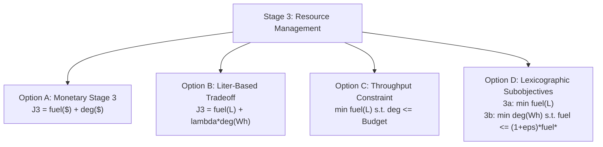

# POLARIS EMS — Stage-3 Formulation Options Analysis

**Objective**: Evaluate four conceptual mathematical formulations for Stage 3 resource management (HD-05 Stage 3 fuel vs degradation tradeoff) without selecting one.

---

## 1. Formulation Summaries

---

## 2. Comprehensive Analysis of Options

### Option A: Monetary Stage 3
- **Mathematical Form**:
  $$J_3 = \sum_{t=1}^H \left( \text{fuel\_cost\_per\_l} \cdot \text{Fuel}[t] + c_{\text{deg}} \cdot (P_{\text{chg}}[t] + P_{\text{dis}}[t]) \Delta t \right) w_t$$
- **Required Inputs & Parameters**:
  1. Authoritative diesel price $[\$/\text{L}]$
  2. Authoritative battery degradation monetary value $[\$/\text{Wh}]$
- **Repository Support**: High technical support in solver (`milp.py`), but **zero empirical/governance calibration** for parameters.
- **Major Advantage**: Standard single-objective scalar linear program.
- **Major Limitation**: Forces artificial monetary pricing on operational parameters.

---

### Option B: Liter-Based Tradeoff
- **Mathematical Form**:
  $$J_3 = \sum_{t=1}^H \left( \text{Fuel}[t] + \lambda_{\text{deg}} \cdot (P_{\text{chg}}[t] + P_{\text{dis}}[t]) \Delta t \right) w_t$$
  where $\lambda_{\text{deg}}$ has units $[\text{L}/\text{Wh}]$.
- **Required Inputs & Parameters**:
  1. Governed exchange coefficient $\lambda_{\text{deg}} \ [\text{L}/\text{Wh}]$ (or $\text{L}/\text{kWh}$).
- **Repository Support**: Requires minor change to objective vector $c$ in `milp.py`.
- **Major Advantage**: Objective function directly measures fuel in physical liters $[\text{L}]$.
- **Major Limitation**: Requires human governance to directly decide $\lambda_{\text{deg}}$.

---

### Option C: Constrained Battery Cycling
- **Mathematical Form**:
  $$\min \sum_{t=1}^H \text{Fuel}[t] \cdot w_t$$
  $$\text{subject to } \sum_{t=1}^H (P_{\text{chg}}[t] + P_{\text{dis}}[t]) \Delta t \le B_{\text{deg}}$$
- **Required Inputs & Parameters**:
  1. Governed horizon battery throughput budget $B_{\text{deg}} \ [\text{Wh}]$.
- **Repository Support**: Fully supported by MILP constraint matrix $A_{\text{ub}}$.
- **Major Advantage**: Completely eliminates monetary exchange factors and scalar weighting ambiguity.
- **Major Limitation**: If budget $B_{\text{deg}}$ is set too tightly during low-solar periods, it may force fuel consumption or infeasibility.

---

### Option D: Lexicographic Subobjectives (Hierarchical Stage 3)
- **Mathematical Form**:
  - **Stage 3a**: Compute minimal fuel consumption $F^* = \min \sum_{t=1}^H \text{Fuel}[t] \cdot w_t$.
  - **Stage 3b**: Minimize cycling subject to fuel bound:
    $$\min \sum_{t=1}^H (P_{\text{chg}}[t] + P_{\text{dis}}[t]) \Delta t$$
    $$\text{subject to } \sum_{t=1}^H \text{Fuel}[t] \cdot w_t \le (1 + \epsilon) F^*$$
- **Required Inputs & Parameters**:
  1. Governed extra-fuel tolerance fraction $\epsilon$ (e.g., $\epsilon = 0.02$, allowing up to $2\%$ extra diesel to save battery cycling).
- **Repository Support**: Supported natively by HiGHS solver multi-objective capabilities or a 2-pass solve.
- **Major Advantage**: Direct, elegant mathematical expression of HD-05B ("spend a little extra fuel to prevent unnecessary cycling").
- **Major Limitation**: Requires multi-pass solve or lexicographic solver configuration.

---

## 3. Comparative Summary

None of the options can be implemented without a formal human governance decision. Option D and Option C avoid inventing uncalibrated monetary parameters, whereas Option A and Option B require explicit monetary/exchange parameter governance.
