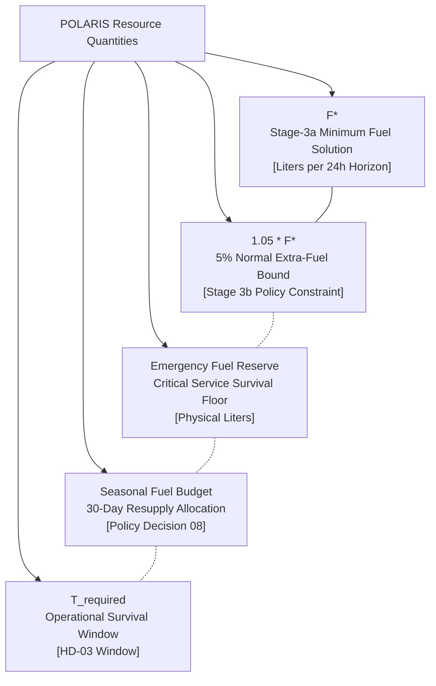

# POLARIS EMS — HD-05 Governance Consistency Matrix

**Audit Objective**: Verify cross-artifact consistency across all HD-05 policy decisions, expected authoritative meanings, implementation references, and concept boundaries.

---

## 1. Decision Traceability Matrix

| Decision ID | Expected Authoritative Meaning | Found in Governance Records? | Conflicting Artifacts Identified? | Final Consistency Status |
| :--- | :--- | :--- | :--- | :--- |
| **HD-05A** | Stage 3 Resource Management placement | Yes (Decision Sheet & Resolution) | None | `CONSISTENT` |
| **HD-05B** | Normal operation extra diesel allowed for cycling reduction | Yes (Decision Sheet & Resolution) | None | `CONSISTENT` |
| **HD-05C** | Emergency operation battery degradation subordinate to critical load | Yes (Decision Sheet & Resolution) | None | `CONSISTENT` |
| **HD-05D** | Stage 3 Lexicographic structure (3a: $\min \text{fuel} \to F^*$; 3b: $\min \text{cycling}$) | Yes (Decision Sheet & Valuation Audit) | Older GAP19 / Scalar MILP docs | `CONSISTENT` (Policy Closed; Code Unmodified) |
| **HD-05D-ε** | RELATIVE tolerance representation ($F_{\text{diesel}} \le (1+\alpha) F^*$) | Yes (Epsilon Audit & Stakeholder Decision) | Absolute-liter notes in early options | `CONSISTENT` (Relative Selected) |
| **HD-05D-α** | $\alpha = 0.05$ ($F_{\text{diesel}} \le 1.05 F^*$) | Yes (Stakeholder Selection) | Pre-closure audit files marked open | `CONSISTENT` ($\alpha=0.05$ Selected) |
| **$c_{\text{deg}}$** | Prototype regularizer ($\$0.00005/\text{Wh}$ in `milp.py`), NOT policy | Yes ([`battery.yaml:L11`](file:///home/punith-bs/01polaris%20%28Copy%29/system/config/battery.yaml#L11)) | None (Properly classified as prototype) | `CONSISTENT` |
| **Fuel Price** | Prototype default ($\$2.50/\text{L}$ in `diesel.yaml`), NOT policy | Yes ([`diesel.yaml:L7`](file:///home/punith-bs/01polaris%20%28Copy%29/system/config/diesel.yaml#L7)) | None (Properly classified as prototype) | `CONSISTENT` |
| **$F^*$** | Stage-3a minimum fuel solution for 24h MPC horizon | Yes (Valuation & Epsilon Audits) | None | `CONSISTENT` |
| **Fuel Reserve** | Emergency protected fuel for grid outage survival | Yes (Survivability Audit) | None | `CONSISTENT` (Kept distinct from $F^*$) |
| **Fuel Budget** | Seasonal resupply-cycle allocation (Decision 08) | Yes (D08 Traceability) | None | `CONSISTENT` (Kept distinct from $F^*$) |
| **$T_{\text{required}}$** | Operational survival window until resupply (HD-03) | Yes (HD-03 Evidence Audit) | None | `CONSISTENT` (Kept distinct from $F^*$) |

---

## 2. Distinct Quantity Boundary Analysis

### Boundary Verification Summary
1. **$F^*$ vs. Emergency Reserve**: $F^*$ is the optimal 24h operational fuel consumption; Emergency Reserve is a physical inventory floor reserved for emergency grid outages.
2. **5% Tolerance vs. Fuel Budget**: The 5% tolerance applies strictly to $F^*$ within a single 24h MPC solve; the Fuel Budget governs long-term 30-day resupply cycles.
3. **Normal vs. Emergency Mode**: 5% slack is active only during NORMAL operation; in EMERGENCY operation, battery degradation is subordinate to critical load.
