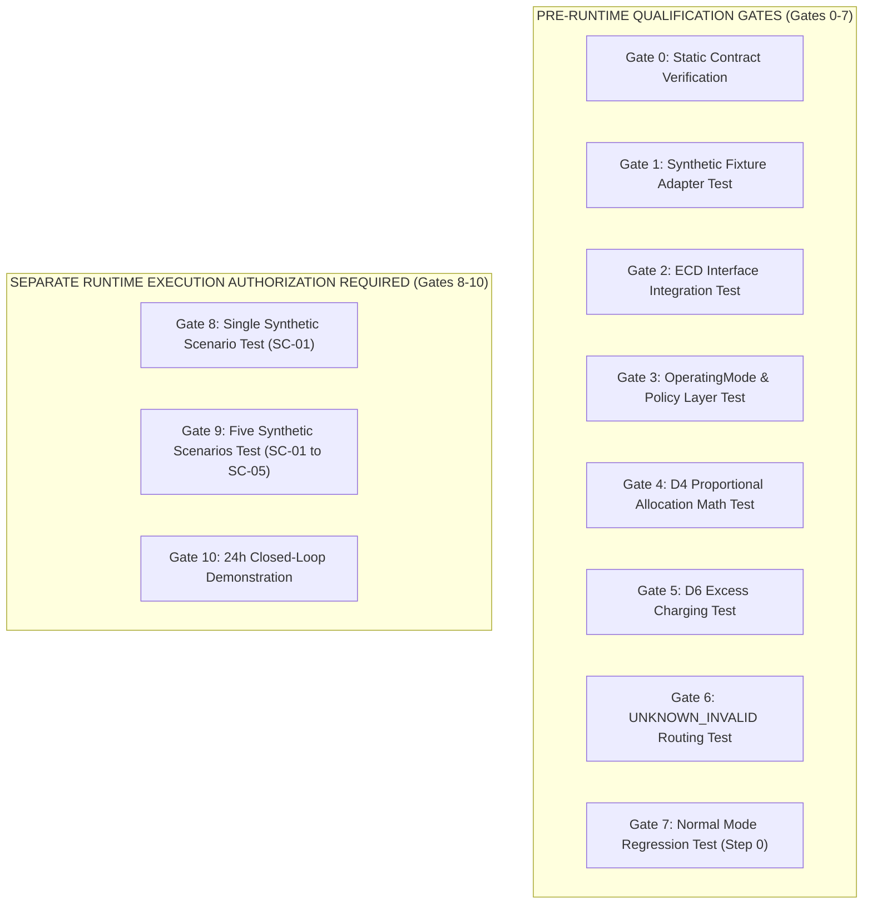

# TEST GATE AUTHORIZATION BOUNDARY CORRECTION

## Correction Summary: Pre-Runtime Qualification vs Runtime Execution

This document establishes the formal separation between **Pre-Runtime Qualification Gates** and **Integrated Runtime Execution Gates**.

---

## 1. Identified Issue in Prior Package Draft

Prior drafts treated all 11 test gates (Gates 0–10) as a single execution block under implementation authorization.

This was incorrect because executing closed-loop simulation across synthetic benchmark scenarios (Gates 8–10) constitutes runtime execution, which requires explicit runtime authorization.

---

## 2. Gate Classification Boundary



---

## 3. Four-Tier Authorization Firewall

To maintain absolute security and clarity, four distinct authorization tiers are established:

```text
1. CODE_IMPLEMENTATION_AUTHORIZATION            = NOT_GRANTED
2. PRE_RUNTIME_QUALIFICATION_AUTHORIZATION       = GATES_0_TO_7_ONLY
3. INTEGRATED_RUNTIME_EXECUTION_AUTHORIZATION    = GATES_8_TO_10_SEPARATE_AUTHORIZATION_REQUIRED
4. PRODUCTION_DEPLOYMENT_AUTHORIZATION           = NOT_GRANTED
```

> [!IMPORTANT]
> - Implementation authorization permits writing code and executing **Gates 0–7** (`PRE_RUNTIME_QUALIFICATION`).
> - **Gates 8–10** require separate human runtime execution sign-off. One authorization level NEVER automatically implies another.
