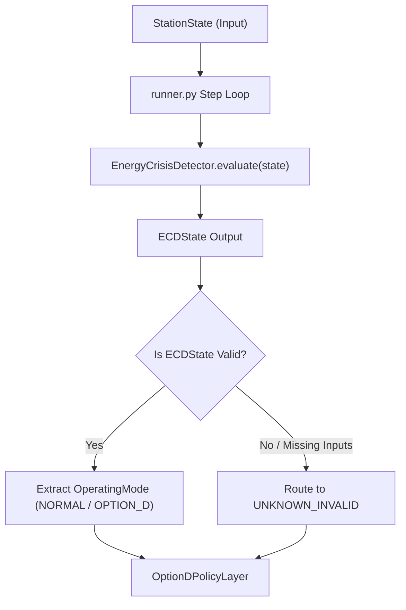

# ECD INTEGRATION AUTHORIZATION SCOPE

## Runtime Wiring Contract for `EnergyCrisisDetector`

This document defines the architectural contract for integrating the frozen `EnergyCrisisDetector` (ECD) class from `system/control/ecd.py` into the main execution runner (`system/runtime/runner.py`).

---

## Integration Architecture

---

## Integration Requirements

### 1. Zero Modification to `ecd.py` Core
- The core logic in `system/control/ecd.py` is **FROZEN** and **UNTOUCHED**.
- Integration is achieved purely by importing `EnergyCrisisDetector` into `runner.py` and calling its `evaluate()` method.

### 2. Information Input Scope
ECD receives strictly controller-permissible inputs available at timestep $t$:
- Current battery state of charge ($\text{SOC}(t)$).
- Current fuel volume ($V_{\text{fuel}}(t)$).
- Current solar and wind availability ($P_{\text{solar}}(t), P_{\text{wind}}(t)$).
- Forecasted demand vector over horizon $H$.
- Governed survivability threshold ($T_{\text{required}} = 6.0\text{h}$).

### 3. State Output Mapping
The returned `ECDState` is mapped to system `OperatingMode` as follows:
- `ECDState.NORMAL` $\longrightarrow$ `OperatingMode.NORMAL`
- `ECDState.EMERGENCY` $\longrightarrow$ `OperatingMode.OPTION_D`
- `ECDState.DEGRADED` $\longrightarrow$ `OperatingMode.OPTION_D` (with log alert for operator escalation)
- `ECDState.UNKNOWN_INVALID` $\longrightarrow$ `OperatingMode.UNKNOWN_INVALID` (routes to protected critical safe state)

### 4. Optimizer Separation Rule
- ECD performs **zero** optimization calculations.
- ECD does **not** solve MILP problems, compute dispatch setpoints, or allocate loads.
- ECD strictly evaluates survivability metrics and emits state classification.
