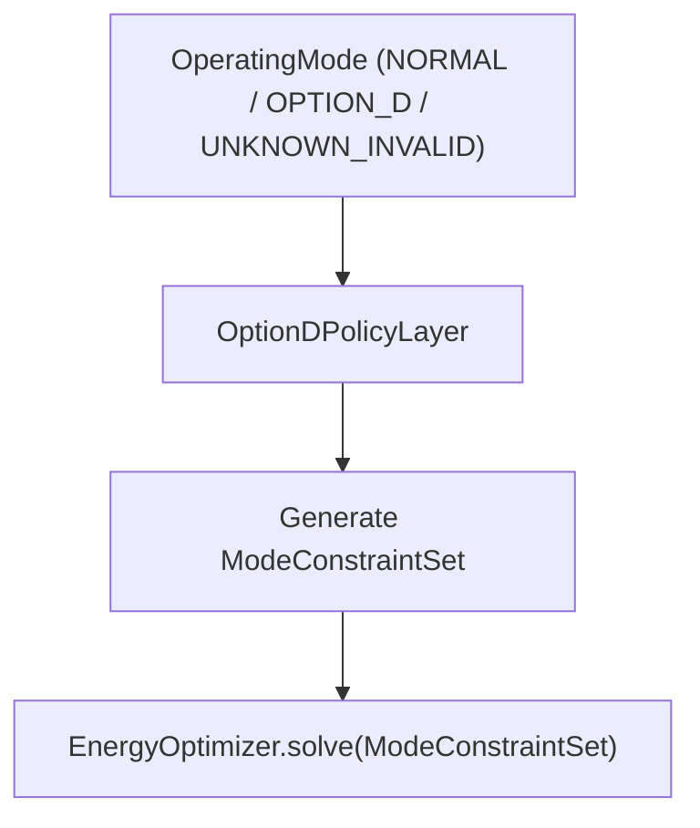

# OPTION D POLICY AUTHORIZATION SCOPE

## Policy Router & Constraint Translator Specification

This document specifies the design and behavioral contract for `OptionDPolicyLayer` and `ModeConstraintSet`. The policy layer serves as a **solver-neutral router** that translates high-level system operating modes into explicit mathematical constraint parameters for `EnergyOptimizer`.

---

## Policy Architecture & Interfaces



---

## `ModeConstraintSet` Data Structure

```python
@dataclass
class ModeConstraintSet:
    operating_mode: str
    
    # Load Bounds
    allow_flexible_load: bool
    critical_load_min_ratio: float      # 1.0 in Normal, alpha(t) in Option D
    flexible_load_max_ratio: float     # 1.0 in Normal, 0.0 in Option D
    
    # Battery Discharge Bounds
    battery_discharge_target: str       # "ALL_LOADS" in Normal, "CRITICAL_ONLY" in Option D
    battery_min_soc: float              # 0.20 (20%)
    battery_max_soc: float              # 0.95 (95%)
    
    # Generator Operating Bounds
    allow_diesel_start: bool
    diesel_excess_to_battery: bool      # True (Enforces D6 excess charging)
    diesel_start_for_battery_only: bool # False (Enforces D6 diesel start restriction)
```

---

## Mode Translation Rules

### 1. `NORMAL` Mode Translation
- `allow_flexible_load = True`
- `critical_load_min_ratio = 1.0`
- `flexible_load_max_ratio = 1.0`
- `battery_discharge_target = "ALL_LOADS"`
- `allow_diesel_start = True`

### 2. `OPTION_D` Mode Translation
- `allow_flexible_load = False`
- `critical_load_min_ratio = alpha(t)` ($0 \le \alpha(t) \le 1$)
- `flexible_load_max_ratio = 0.0` (Flexible loads shed completely)
- `battery_discharge_target = "CRITICAL_ONLY"`
- `diesel_excess_to_battery = True` (D6)
- `diesel_start_for_battery_only = False` (D6)

### 3. `UNKNOWN_INVALID` Mode Translation
- `allow_flexible_load = False`
- `critical_load_min_ratio = alpha(t)`
- `flexible_load_max_ratio = 0.0`
- `battery_discharge_target = "CRITICAL_ONLY"`
- Emits high-priority warning log for emergency operator intervention.

---

## Non-Optimizer Guarantee

> [!IMPORTANT]
> `OptionDPolicyLayer` is **NOT** a second optimizer. It performs zero iterative math or objective evaluations. It acts strictly as a deterministic translation function that populates `ModeConstraintSet`.
