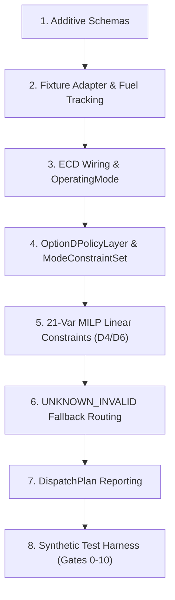

# PRE-GAP19 IMPLEMENTATION SCOPE

## Strategy 2 Implementation Readiness Evaluation

This document explicitly defines the **Pre-GAP19 Implementation Scope** (Strategy 2) and evaluates the exact authorization readiness status for each of the 15 candidate implementation components.

---

## Component Readiness Register

| Component # | Component Name | Readiness Status | Rationale / Dependency |
| :--- | :--- | :--- | :--- |
| **1** | Additive Schema Extensions | `READY_FOR_AUTHORIZATION` | Non-breaking optional fields defined for `StationState`, `ForecastBundle`, `DispatchPlan`. |
| **2** | `SyntheticFixtureProvider` | `READY_FOR_AUTHORIZATION` | Ingestion adapter logic defined; isolates 45 kW synthetic fixture from forecasting. |
| **3** | ECD Runtime Wiring | `READY_FOR_AUTHORIZATION` | `EnergyCrisisDetector` class is fully tested; requires integration into `runner.py`. |
| **4** | OperatingMode Propagation | `READY_FOR_AUTHORIZATION` | Enum routing defined for `NORMAL`, `OPTION_D`, `UNKNOWN_INVALID`. |
| **5** | `OptionDPolicyLayer` | `READY_FOR_AUTHORIZATION` | Policy translation logic defined; translates mode to `ModeConstraintSet`. |
| **6** | Solver-Neutral `ModeConstraintSet` | `READY_FOR_AUTHORIZATION` | Data structure specifying variable bounds, active constraints, and load rules defined. |
| **7** | Critical/Flexible Load Split | `READY_FOR_AUTHORIZATION` | Formulated in 21-variable MILP model; decouples critical $P_c$ from flexible $P_f$. |
| **8** | D4 Proportional Allocation ($P_{i,\text{served}} = \alpha P_{i,\text{min}}$) | `READY_FOR_AUTHORIZATION` | Formulated as linear constraints in MILP; zero-denominator edge case explicitly flagged. |
| **9** | D6 Excess Generation Charging | `READY_FOR_AUTHORIZATION` | Formulated via binary generator status $u_{\text{gen}}(t)$ and battery balance equations. |
| **10** | `UNKNOWN_INVALID` Routing | `READY_FOR_AUTHORIZATION` | Fallback routing path to Option D protected critical safe state defined. |
| **11** | `DispatchPlan` Reporting | `READY_FOR_AUTHORIZATION` | Additive fields for $\alpha(t)$, critical load served, and curtailment defined. |
| **12** | Synthetic Test Harness | `READY_FOR_AUTHORIZATION` | Test script structure defined to execute Gates 0 through 10. |
| **13** | Fuel-State Tracking | `READY_FOR_AUTHORIZATION` | Fuel mass-balance equation defined for closed-loop synthetic simulation. |
| **14** | Unit Tests | `READY_FOR_AUTHORIZATION` | Isolated component tests defined for Gates 1–6. |
| **15** | Static Integration Tests | `READY_FOR_AUTHORIZATION` | Regression test suite defined for Normal mode dispatch (Gate 7). |

---

## Strategy 2 Implementation Sequence

If authorized by human decision-makers, implementation will follow this exact order:

> [!IMPORTANT]
> **NO GAP19 SOLVER MODIFICATIONS**: Pre-GAP19 scope uses the existing SciPy HiGHS scalar solver engine and does **not** modify solver architecture, multi-objective lexicographic stages, or C++ native bindings.
