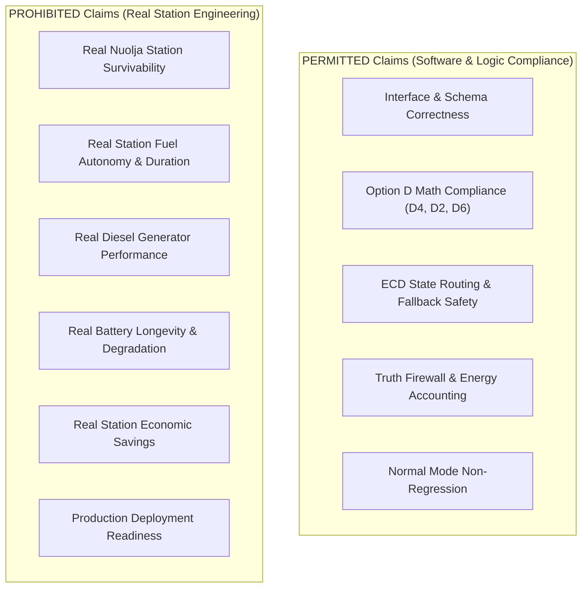

# SCIENTIFIC CLAIM BOUNDARY

## Permitted vs Prohibited Scientific Claims

This document defines the strict boundary governing all scientific, engineering, and operational claims derived from the pre-GAP19 Option D implementation and synthetic demonstrations.

---

## Authoritative Claim Boundaries

---

## 1. Permitted Claims
Future synthetic runtime demonstrations (Gates 0–10) MAY legitimately claim:
- **Software Integration Correctness**: Demonstrates clean data flow across schemas, ECD, policy layer, optimizer, and Digital Twin.
- **Mathematical Compliance**: Proves exact linear constraint enforcement of $D4$ proportional load allocation ($P_{i,\text{served}} = \alpha P_{i,\text{min}}$), $D2$ battery restrictions, and $D6$ excess charging under synthetic assumptions.
- **Deterministic Routing**: Proves that untrusted/corrupted inputs correctly route to `UNKNOWN_INVALID` protected critical safe state without silent failure.
- **Non-Anticipative Causality**: Proves that the controller operates strictly within the causal truth firewall without leaking future ground truth.
- **Normal Mode Preservation**: Proves zero regression in Normal mode dispatch setpoints.

---

## 2. Prohibited Claims
Future synthetic runtime demonstrations MUST NOT claim:
- **Real Station Survivability**: MUST NOT claim that Nuolja station will survive a 6-hour or 72-hour power grid loss based on synthetic fixture runs.
- **Real Fuel Autonomy**: MUST NOT claim specific fuel lifetime (e.g., "500 L lasts X days") for actual station generators.
- **Real Equipment Requirements**: MUST NOT claim that 15 kW heating, 10 kW water, or 5 kW comms represent actual Nuolja critical load minimums.
- **Economic / Commercial Benefit**: MUST NOT make financial savings or commercial ROI claims.
- **Production Deployment Readiness**: MUST NOT claim that the synthetic implementation is ready for live operational deployment without site-specific engineering inputs and GAP19 multi-objective solver integration.
