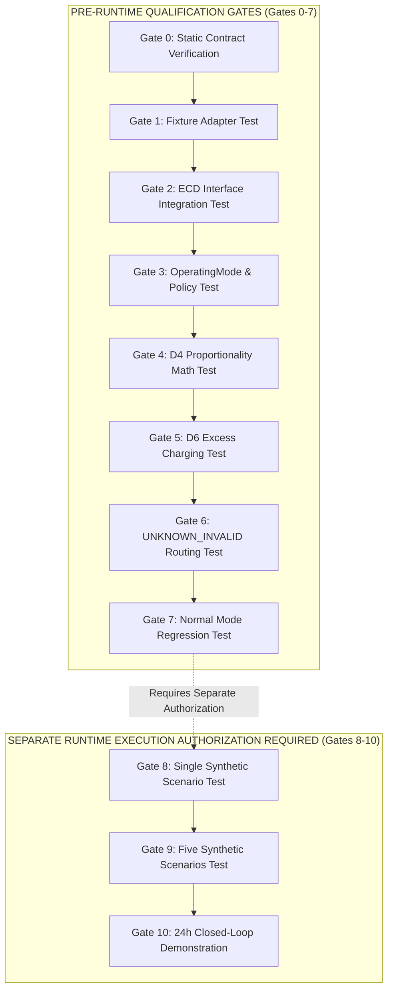

# TEST GATE PLAN

## Sequential Pre-Implementation & Runtime Validation Pipeline

This document defines the 11 sequential test gates required for qualification and runtime execution. It explicitly separates pre-runtime qualification gates from integrated runtime execution gates.

---

## Validation Gate Pipeline Overview

---

## Authorization Boundary Separation

> [!CAUTION]
> **GATE AUTHORIZATION SEPARATION**:
> - **GATES 0 TO 7 (`PRE_RUNTIME_QUALIFICATION`)**: Unit tests, schema validation, static contract checks, and isolated solver math verification. Implementation authorization permits running Gates 0–7 for pre-runtime qualification.
> - **GATES 8 TO 10 (`SEPARATE_EXECUTION_AUTHORIZATION_REQUIRED`)**: Closed-loop simulation and dynamic synthetic scenario executions (SC-01 to SC-05). **Gates 8–10 require separate runtime execution authorization.** Implementation authorization does NOT imply runtime execution authorization.

---

## Detailed Gate Specifications

### GATE 0: Static Contract Verification (`PRE_RUNTIME_QUALIFICATION`)
- **Preconditions**: Code modifications written; zero runtime calls.
- **Test Purpose**: Verify static type safety, schema definitions, and file boundaries.
- **Pass Conditions**: `mypy` / `flake8` pass with 0 errors; all imports resolve.
- **Fail Conditions**: Any lint error, missing field, or broken import.
- **Scientific Claim Limit**: Proves syntactic correctness only.

### GATE 1: Synthetic Fixture Adapter Test (`PRE_RUNTIME_QUALIFICATION`)
- **Preconditions**: Gate 0 passed; `SyntheticFixtureProvider` implemented.
- **Test Purpose**: Ingest synthetic fixture JSON and verify parsing into additive `StationState` fields.
- **Pass Conditions**: `critical_demand == 30.0`, `flexible_demand == 15.0`, vector parsed.
- **Fail Conditions**: Incorrect sum, unparsed fields, or schema error.
- **Scientific Claim Limit**: Proves fixture parsing correctness.

### GATE 2: ECD Interface Integration Test (`PRE_RUNTIME_QUALIFICATION`)
- **Preconditions**: Gate 1 passed; ECD wired into `runner.py`.
- **Test Purpose**: Verify `EnergyCrisisDetector.evaluate()` execution within runner.
- **Pass Conditions**: Valid `ECDState` returned for all fixture states.
- **Fail Conditions**: Runner crash, unhandled state, or `ecd.py` modification.
- **Scientific Claim Limit**: Proves ECD execution integration.

### GATE 3: OperatingMode & Policy Layer Test (`PRE_RUNTIME_QUALIFICATION`)
- **Preconditions**: Gate 2 passed; `OptionDPolicyLayer` implemented.
- **Test Purpose**: Verify `ECDState` translation into `ModeConstraintSet`.
- **Pass Conditions**: Correct constraint flags set for `NORMAL`, `OPTION_D`, and `UNKNOWN_INVALID`.
- **Fail Conditions**: Incorrect mode mapping or policy layer crash.
- **Scientific Claim Limit**: Proves policy routing determinism.

### GATE 4: D4 Mathematical Constraint Test (`PRE_RUNTIME_QUALIFICATION`)
- **Preconditions**: Gate 3 passed; proposed pre-GAP19 21-variable formulation implemented.
- **Test Purpose**: Verify $D4$ proportional load allocation ($P_{i,\text{served}} = \alpha P_{i,\text{min}}$) during power deficits.
- **Pass Conditions**: All categories allocated equal ratio $\alpha(t)$; $0 \le \alpha(t) \le 1$. Zero-denominator edge case handled safely.
- **Fail Conditions**: Unequal category ratios, priority bias, or solver infeasibility.
- **Scientific Claim Limit**: Proves D4 mathematical formulation correctness.

### GATE 5: D6 Excess Charging Test (`PRE_RUNTIME_QUALIFICATION`)
- **Preconditions**: Gate 4 passed; generator bounds implemented.
- **Test Purpose**: Verify D6 excess diesel generation routes to battery charging before curtailment.
- **Pass Conditions**: Excess generation charges battery; diesel never starts solely for battery charging.
- **Fail Conditions**: Diesel starting for battery charging, or excess curtailed while battery has headroom.
- **Scientific Claim Limit**: Proves D6 generator rule correctness.

### GATE 6: UNKNOWN_INVALID Routing Test (`PRE_RUNTIME_QUALIFICATION`)
- **Preconditions**: Gate 5 passed; fallback path implemented.
- **Test Purpose**: Inject missing/corrupted telemetry inputs and verify routing.
- **Pass Conditions**: System transitions to `OperatingMode.UNKNOWN_INVALID` and enters protected critical safe state.
- **Fail Conditions**: Silent crash, unhandled exception, or dispatch in Normal mode.
- **Scientific Claim Limit**: Proves untrusted input fallback safety.

### GATE 7: Normal Mode Regression Test (`PRE_RUNTIME_QUALIFICATION`)
- **Preconditions**: Gate 6 passed.
- **Test Purpose**: Run SC-01 (Normal scenario) step 0 and verify 100% equivalence to pre-Option D dispatch.
- **Pass Conditions**: Dispatch setpoints match baseline within float tolerance ($10^{-5}$).
- **Fail Conditions**: Any deviation in Normal mode dispatch setpoints.
- **Scientific Claim Limit**: Proves zero regression in Normal mode.

---

## Separate Runtime Execution Gates

### GATE 8: Single Synthetic Scenario Test (SC-01) (`SEPARATE_EXECUTION_AUTHORIZATION_REQUIRED`)
- **Preconditions**: Gate 7 passed AND separate execution authorization granted.
- **Test Purpose**: Run 24-step closed-loop simulation on SC-01 (Normal).
- **Pass Conditions**: All 24 steps execute cleanly; zero constraint violations.
- **Fail Conditions**: Closed-loop step failure, SOC drift, or fuel mass-balance error.
- **Scientific Claim Limit**: Proves single-scenario closed-loop stability.

### GATE 9: All Five Synthetic Scenarios Test (SC-01 to SC-05) (`SEPARATE_EXECUTION_AUTHORIZATION_REQUIRED`)
- **Preconditions**: Gate 8 passed AND separate execution authorization granted.
- **Test Purpose**: Execute closed-loop simulation across all 5 benchmark scenarios (SC-01 to SC-05).
- **Pass Conditions**: 100% clean execution across all scenarios; exact D4/D6 compliance.
- **Fail Conditions**: Any step failure or rule violation in any scenario.
- **Scientific Claim Limit**: Proves multi-scenario benchmark robustness.

### GATE 10: 24-Hour Closed-Loop Demonstration (`SEPARATE_EXECUTION_AUTHORIZATION_REQUIRED`)
- **Preconditions**: Gate 9 passed AND separate execution authorization granted.
- **Test Purpose**: Full 24-hour synthetic demonstration with dynamic load profiles and truth firewall verification.
- **Pass Conditions**: Full 24h stability; 0 truth leakage; exact energy accounting.
- **Fail Conditions**: Any instability, truth leakage, or energy balance discrepancy.
- **Scientific Claim Limit**: Proves software integration and benchmark compliance.
