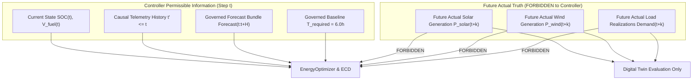

# TRUTH FIREWALL

## Controller Causality & Non-Anticipative Isolation

This document defines the strict **Truth Firewall** separating controller-permissible information from future ground truth.

---

## Causal Information Scope

---

## Enforced Firewall Rules

1. **Non-Anticipative Control**: `EnergyCrisisDetector`, `OptionDPolicyLayer`, and `EnergyOptimizer` MUST make decisions based strictly on state at step $t$ and forecasted quantities over horizon $H$.
2. **Evaluation Separation**: Future ground truth trajectories (actual solar, actual wind, actual demand) are consumed **only** by `system/simulation/simulator.py` to evaluate closed-loop dispatch performance.
3. **No Clairvoyance**: Optimization models must NOT inspect future environment steps to retroactively adjust $t=0$ dispatch setpoints.
