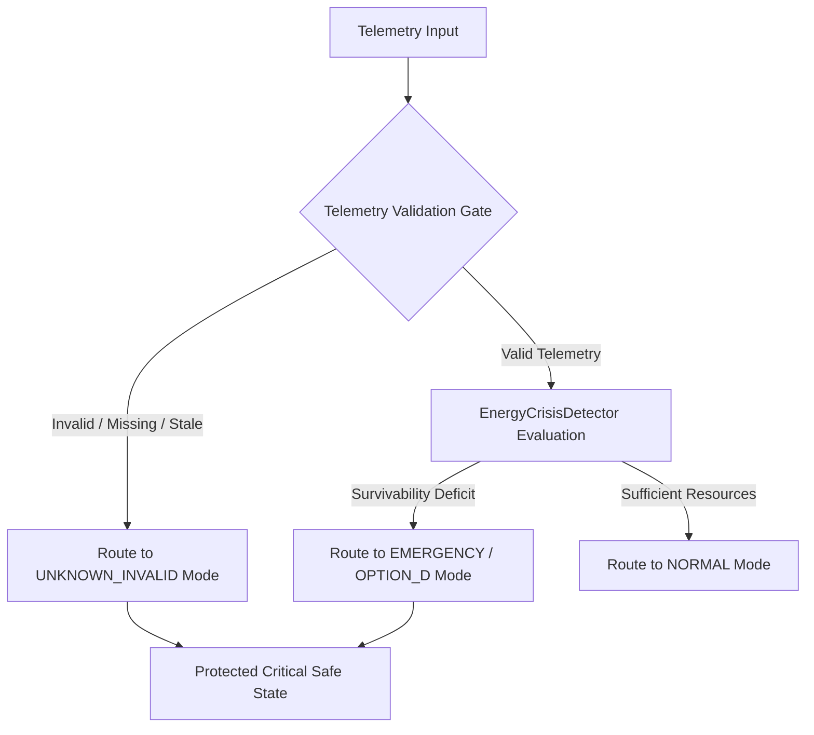

# UNKNOWN_INVALID AUTHORIZATION SCOPE

## Untrusted Input Routing & Safe-State Architecture

This document defines the architectural contract for handling `UNKNOWN_INVALID` input states within the POLARIS EMS runtime.

---

## Provenance Separation

It is critical to distinguish between valid emergency states and invalid sensor states:

- **`EMERGENCY` (`OPTION_D`)**: Valid telemetry indicates physical resource survivability failure ($T_{\text{surv}} < T_{\text{required}}$).
- **`UNKNOWN_INVALID` (`OPTION_D`)**: Telemetry cannot be trusted because required inputs are invalid, missing, stale, corrupted, or unauthorized.

---

## Safe-State Dispatch Rules

When `UNKNOWN_INVALID` is triggered:
1. System transitions to `OperatingMode.UNKNOWN_INVALID`.
2. Flexible loads are immediately shed ($P_{\text{flex,served}} = 0$).
3. Battery discharge is restricted strictly to protected critical loads ($P_{\text{bat,dis,flex}} = 0$).
4. Diesel generator is enabled only as physical backup for critical load minimums.
5. High-priority operator alert and cryptographic audit log entry are generated.

> [!CAUTION]
> **NO SILENT MASKING**: `UNKNOWN_INVALID` must **NEVER** be silently treated as valid normal data, nor should default fallbacks swallow input errors. Input corruption must remain transparent and auditable.
