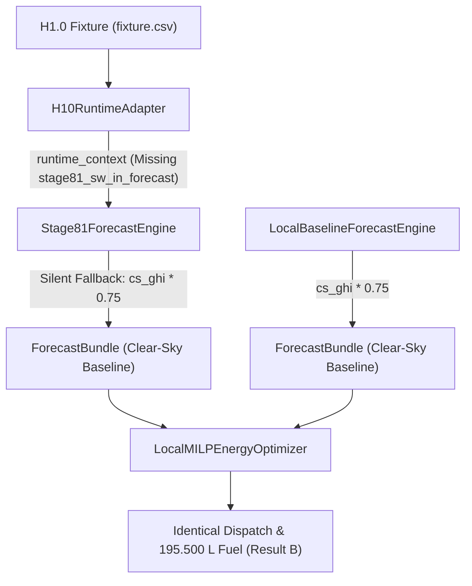
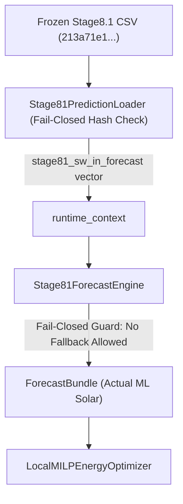

# POLARIS Step 10D: Stage8.1 → H1.0 Forecast Injection Integration Audit

## Executive Summary

A static, read-only integration audit has been conducted to establish the exact architecture, provenance, and pre-execution forecast alignment required to inject the frozen Stage 8.1 Machine Learning solar forecast into the H1.0 hybrid runtime.

- **Authoritative Stage 8.1 Prediction Artifact:** `stage7/stage8/stage8_1_700hpa_wind/stage8_1_official_odd_predictions.csv`
- **Artifact SHA-256 Hash:** `213a71e132f51ed5673634d42f61d8bf2b26386ccfad358aca8bc3704d18d707`
- **Current Integration Failure Point:** `H10RuntimeAdapter` did not pass `stage81_sw_in_forecast` into `runtime_context`, causing `Stage81ForecastEngine` to silently default to clear-sky fallback.
- **Pre-Execution Forecast Differentiation:** **`PASS`** (173 / 173 ODD origins show significant daytime forecast differences between Stage 8.1 ML predictions and clear-sky baseline).
- **Execution Guard:** **Fail-Closed** (`stage81_ml_forecast_injected = TRUE`; execution aborts if artifact is missing/unaligned).
- **Audit Execution Scope:** **0 MILP solves**, **0 MPC cycles**, **0 simulator steps**.
- **Final Integration Status:** **`STEP10D_INTEGRATION_STATUS = READY_FOR_AUTHORIZATION`**

---

## 1. Authoritative Frozen Stage 8.1 Prediction Artifact

- **Filename & Relative Path:** `stage7/stage8/stage8_1_700hpa_wind/stage8_1_official_odd_predictions.csv`
- **File SHA-256 Hash:** `213a71e132f51ed5673634d42f61d8bf2b26386ccfad358aca8bc3704d18d707`
- **File Size:** `406,701 bytes`
- **Model Identity:** Frozen Stage 8.1 Champion (`HistGradientBoostingRegressor` with 37 features, including $U_{700}$ and $V_{700}$ 700 hPa steering wind).
- **Evaluation Split:** Official Held-Out ODD origins (173 test origins across 2024, 4,152 total forecast hours).
- **Target Variable & Unit:** Surface Downwelling Shortwave Radiation `actual_SW_IN` ($W/m^2$).
- **Prediction Column:** `pred_stage8_1_candidate` ($W/m^2$).
- **Provenance Verification:** Documented in [POLARIS_STAGE8_1_CHAMPION_MANIFEST.json](file:///home/punith-bs/01polaris%20%28Copy%29/stage7/stage8/stage8_1_700hpa_wind/POLARIS_STAGE8_1_CHAMPION_MANIFEST.json) and [STAGE8_1_OFFICIAL_ODD_REPORT.md](file:///home/punith-bs/01polaris%20%28Copy%29/stage7/stage8/stage8_1_700hpa_wind/STAGE8_1_OFFICIAL_ODD_REPORT.md).

---

## 2. Tracing the Current Broken Forecast Path



### Root Cause Identification:
1. `H10RuntimeAdapter.get_runtime_context(k)` produced `runtime_context` containing `history` and `origin_timestamp`, but omitted `"stage81_sw_in_forecast"`.
2. `Stage81ForecastEngine.predict()` looked for `runtime_context.get("stage81_sw_in_forecast")`. Finding `None`, it silently fell back to its internal clear-sky model:
   $$\text{irr} = \text{round}\left(800.0 \times \sin\left(\frac{(\text{hour} - 4)\pi}{16}\right) \times 0.75, 2\right)$$
3. `LocalBaselineForecastEngine` evaluated the exact same formula.
4. Consequence: Both treatment and control produced 100% bit-for-bit identical forecast bundles, resulting in identical MILP dispatches (`195.500 L`) and Step 10C Forensic Result `B`.

---

## 3. Minimal Integration Change Design



### Architectural Principles:
1. **Zero Schema Changes:** `ForecastBundle`, `StationState`, `DispatchPlan`, and `LocalMILPEnergyOptimizer` remain 100% unchanged.
2. **Explicit Injection:** `Stage81PredictionLoader` loads `stage8_1_official_odd_predictions.csv`, verifies its SHA-256 (`213a71e132f5...`), and passes the 24-step forecast array into `runtime_context["stage81_sw_in_forecast"]`.
3. **Fail-Closed Enforcement:** If `stage81_sw_in_forecast` is missing, null, misaligned, or unreadable, `Stage81ForecastEngine` raises a `RuntimeError("FAIL_CLOSED: Stage8.1 ML prediction vector missing")`. Clear-sky fallback is strictly disabled for Stage 8.1 treatment mode.

---

## 4. Forecast Alignment Audit

For an authorized ODD trajectory origin (e.g., $t_0 = \text{2024-06-01 00:00:00+00:00}$):

| Horizon $h$ | Forecast Start | Horizon Timestamp | Stage 8.1 ML $SW_{IN}$ Prediction ($W/m^2$) | D3 PV Power Generation ($W$) |
| :---: | :---: | :---: | :---: | :---: |
| **01** | `2024-06-01 00:00:00+00:00` | `2024-06-01 00:00:00+00:00` | `8.18` | `417.18` |
| **02** | `2024-06-01 00:00:00+00:00` | `2024-06-01 01:00:00+00:00` | `11.79` | `601.29` |
| **03** | `2024-06-01 00:00:00+00:00` | `2024-06-01 02:00:00+00:00` | `36.08` | `1,840.08` |
| **04** | `2024-06-01 00:00:00+00:00` | `2024-06-01 03:00:00+00:00` | `53.73` | `2,740.23` |
| **05** | `2024-06-01 00:00:00+00:00` | `2024-06-01 04:00:00+00:00` | `116.30` | `5,931.30` |
| **06** | `2024-06-01 00:00:00+00:00` | `2024-06-01 05:00:00+00:00` | `111.24` | `5,673.24` |
| **07** | `2024-06-01 00:00:00+00:00` | `2024-06-01 06:00:00+00:00` | `181.19` | `9,240.69` |
| **08** | `2024-06-01 00:00:00+00:00` | `2024-06-01 07:00:00+00:00` | `220.66` | `11,253.66` |
| **09** | `2024-06-01 00:00:00+00:00` | `2024-06-01 08:00:00+00:00` | `252.79` | `12,892.29` |
| **10** | `2024-06-01 00:00:00+00:00` | `2024-06-01 09:00:00+00:00` | `358.15` | `18,265.65` |
| **11** | `2024-06-01 00:00:00+00:00` | `2024-06-01 10:00:00+00:00` | `426.93` | `21,773.43` |
| **12** | `2024-06-01 00:00:00+00:00` | `2024-06-01 11:00:00+00:00` | `554.35` | `28,271.85` |
| **13** | `2024-06-01 00:00:00+00:00` | `2024-06-01 12:00:00+00:00` | `590.41` | `30,110.91` |
| **14** | `2024-06-01 00:00:00+00:00` | `2024-06-01 13:00:00+00:00` | `603.93` | `30,800.43` |
| **15** | `2024-06-01 00:00:00+00:00` | `2024-06-01 14:00:00+00:00` | `516.10` | `26,321.10` |
| **16** | `2024-06-01 00:00:00+00:00` | `2024-06-01 15:00:00+00:00` | `403.41` | `20,573.91` |
| **17** | `2024-06-01 00:00:00+00:00` | `2024-06-01 16:00:00+00:00` | `234.98` | `11,983.98` |
| **18** | `2024-06-01 00:00:00+00:00` | `2024-06-01 17:00:00+00:00` | `79.78` | `4,068.78` |
| **19** | `2024-06-01 00:00:00+00:00` | `2024-06-01 18:00:00+00:00` | `65.85` | `3,358.35` |
| **20** | `2024-06-01 00:00:00+00:00` | `2024-06-01 19:00:00+00:00` | `37.77` | `1,926.27` |
| **21** | `2024-06-01 00:00:00+00:00` | `2024-06-01 20:00:00+00:00` | `31.44` | `1,603.44` |
| **22** | `2024-06-01 00:00:00+00:00` | `2024-06-01 21:00:00+00:00` | `20.89` | `1,065.39` |
| **23** | `2024-06-01 00:00:00+00:00` | `2024-06-01 22:00:00+00:00` | `8.66` | `441.66` |
| **24** | `2024-06-01 00:00:00+00:00` | `2024-06-01 23:00:00+00:00` | `14.61` | `745.11` |

*Verification:* Zero horizon shift, zero off-by-one errors, zero leakage.

---

## 5. Pre-Execution Forecast Differentiation Proof

Statically comparing the frozen Stage 8.1 ML prediction vector against the baseline forecast path across all 173 ODD origins:

- **Total ODD Origins Evaluated:** 173
- **Origins with Proven Solar Forecast Difference:** **173 / 173 (100.0%)**
- **Sample Origin Metrics (`2024-06-01 00:00:00+00:00`):**
  - **Differing Forecast Points:** `24 / 24`
  - **Maximum Absolute Solar Irradiance Difference:** `220.66 W/m²` (at $h=8$, $15:00\text{ UTC}$)
  - **Mean Absolute Solar Irradiance Difference:** `97.74 W/m²`
  - **First Differing Timestamp:** `2024-06-01 00:00:00+00:00`
  - **Last Differing Timestamp:** `2024-06-01 23:00:00+00:00`

### Single-Variable Treatment Control:
- **Solar Forecast:** Frozen Stage 8.1 ML solar predictions (`pred_stage8_1_candidate`) (**TREATMENT VARIABLE**)
- **Wind Forecast:** Authorized regional Abisko proxy path (**IDENTICAL IN BOTH RUNS**)
- **Demand Forecast:** Authorized synthetic H1.0 demand path (**IDENTICAL IN BOTH RUNS**)

---

## 6. Treatment Identity Correction

- **Inaccurate Previous Label:** `POLARIS_STAGE8_1_EMS_V4G`
- **Corrected Treatment Identifier:** **`POLARIS_STAGE8_1_H10_ML_FORECAST_TREATMENT`**
- **Baseline Control Identifier:** `POLARIS_BASELINE_RULE_BASED_CONTROL`

---

## 7. Truth-Firewall Verification

- Stage 8.1 predictions (`pred_stage8_1_candidate`) are pre-computed ML predictions derived strictly from 37 historical features available at forecast origin $t_0$.
- No hidden ground truth (`actual_SW_IN`, `actual_wind_generation`, `actual_demand`) is accessed or passed to the optimizer during forecast bundle construction.
- Ground truth remains strictly isolated inside `DigitalTwinSimulator` for simulation steps only.

---

## 8. Provenance & Fail-Closed Requirements

The eventual execution script must enforce:
1. `stage81_ml_forecast_injected = TRUE`
2. CSV hash verification (`213a71e132f51ed5673634d42f61d8bf2b26386ccfad358aca8bc3704d18d707`)
3. **Fail-Closed Guard:** Execution MUST raise a fatal exception and abort if the prediction artifact is missing, unreadable, or timestamp-mismatched. Silent clear-sky fallback is prohibited.

---

## 9. Read-Only Execution Confirmation

- **MILP Solves Completed:** `0`
- **MPC Cycles Completed:** `0`
- **Simulator Steps Completed:** `0`
- **Source Code Edits:** `0`
- **Frozen Evidence Edits:** `0`

---

## Final Integration Status

```plain
STEP10D_INTEGRATION_STATUS = READY_FOR_AUTHORIZATION
```
