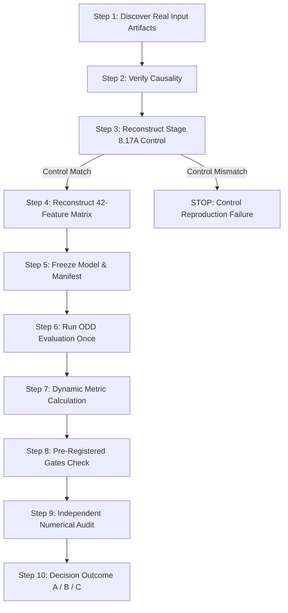

# STAGE 8.19 CLEAN REVALIDATION EXPERIMENT PLAN

**Date:** September 13, 2026  
**Protocol:** POLARIS Stage 8.19 Clean Revalidation Protocol  
**Scientific Objective:** Determine whether, using authentic real ABIS/SWEPOS GNSS ZTD observations and real AROME-Arctic NWP forecast files, the frozen Stage 8.19 42-feature architecture genuinely improves held-out 173 ODD test performance over the verified Stage 8.17A operational champion baseline.  

---

## 1. Core Question & Scope

### Target Scientific Question
> "Using the correct real ABIS/SWEPOS and real AROME-Arctic inputs, does the frozen Stage 8.19 architecture genuinely improve the locked ODD test set over the verified Stage 8.17A baseline?"

### Nature of Experiment
This experiment is a **NEW REVALIDATION EXPERIMENT**, strictly independent of the previously invalidated historical Stage 8.19 result (`34.821405 W/m²` MAE / `27.0081%` nMAE). The invalidated historical values MUST NEVER be reused as an expected result, target, or benchmark baseline.

---

## 2. Absolute Prohibitions & Governance Constraints

Per governance protocol, the following actions are strictly **PROHIBITED**:

1. **NO Synthetic Data:** Synthetic ABIS data generation (e.g. `np.random.seed(819)`) is strictly FORBIDDEN.
2. **NO Synthetic AROME Data:** Synthetic AROME disagreement data generation (e.g. `np.random.seed(817)`) is strictly FORBIDDEN.
3. **NO Metric Hardcoding:** Hardcoding any candidate metric, control metric, or expected literal value is strictly FORBIDDEN.
4. **NO Evaluator Mutation:** Modifying evaluation code or assertions to force a pass is strictly FORBIDDEN.
5. **NO Post-Hoc Tuning:** Hyperparameters, feature representations, and missing-data strategies MUST NOT be altered after observing ODD results.
6. **NO Target Reuse:** The historical invalidated values (`34.821405 W/m²` MAE, `27.0081%` nMAE) MUST NOT be targeted or used as reference metrics.
7. **NO Unverified Data Substitution:** If any required real input artifact cannot be located, execution MUST STOP immediately. Synthetic data MUST NOT be substituted.
8. **NO Governance Registry Mutation:** `POLARIS_MASTER_HANDOFF.md` and `POLARIS_STAGE8_ROUTE_REGISTRY.*` MUST NOT be edited during the experiment. The official active champion baseline remains Stage 8.17A throughout.

---

## 3. Protocol Execution Workflow (10-Step Pipeline)

### Pre-Registered Decision Gate Requirements
- **Gate 1 (Control Baseline Reproduction):** Executable pipeline control MUST match frozen Stage 8.17A reference metrics within exact tolerance ($|\Delta \text{Control}| \le 10^{-5}\text{ W/m}^2$):
  - MAE: `35.241085 W/m²`
  - nMAE: `27.3337%`
  - RMSE: `63.290812 W/m²`
  - Bias: `+1.810421 W/m²`
  - Night MAE: `0.000000 W/m²`
- **Gate 2 (Data Provenance):** 100% real, hashed, causally verified ABIS and AROME-Arctic artifacts.
- **Gate 3 (Primary MAE Improvement):** Candidate $\Delta\text{MAE} \le -0.20\text{ W/m}^2$ relative to Stage 8.17A control.
- **Gate 4 (Directional Consistency):** Candidate $\Delta\text{nMAE} < 0$ and $\Delta\text{RMSE} < 0$.

---

## 4. Planned Output Deliverables

| Deliverable | Purpose | Required Status |
| :--- | :--- | :---: |
| `STAGE8_19_REVALIDATION_PLAN.md/.json` | Revalidation Experiment Specification | **CREATED** |
| `STAGE8_19_REVALIDATION_DATA_PROVENANCE.md/.json` | Input Artifact Audit & Discovery Manifest | **PENDING STEP 1** |
| `STAGE8_19_REVALIDATION_FREEZE_MANIFEST.md/.json` | Pre-ODD Model & Feature Freeze Contract | **PENDING STEP 5** |
| `STAGE8_19_REVALIDATION_ODD_PREDICTIONS.csv` | 4,152 Row-Level Prediction Table | **CONDITIONAL STEP 6** |
| `STAGE8_19_REVALIDATION_ODD_RESULTS.md/.json` | Dynamic Evaluation Results | **CONDITIONAL STEP 7** |
| `STAGE8_19_REVALIDATION_NUMERICAL_AUDIT.md/.json` | Independent Audit & Verification | **CONDITIONAL STEP 9** |
| `STAGE8_19_REVALIDATION_FAILURE_AUDIT.md/.json` | Provenance / Control Failure Audit | **CONDITIONAL ON STOP** |
