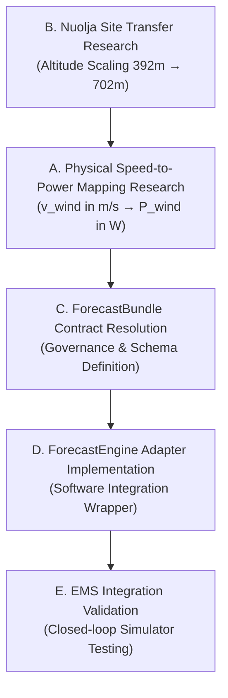

# POLARIS PATH A — WIND INTEGRATION PREREQUISITE DECISION GATE

**Governance Stage:** Post-A2 Integration Readiness → Next Authorized Work Selection  
**Document Type:** Decision Gate & Dependency Analysis  
**Timestamp (UTC):** 2026-09-18T04:17:15Z  
**Status:** COMPLETE  

---

## 1. Current Verified A2 State

The A2 Wind Model Development & Training phase and subsequent Post-A2 Evidence Audit established the following verified research baseline:

- **Research Champion:** Candidate 3 — Autoregressive Ridge Regression (AR-X)
- **Champion Audit Status:** `VERIFIED_WITH_LIMITATIONS`
- **Target Variable:** 10 m Wind Speed ($v_{\text{wind}}$)
- **Target Units:** $\text{m/s}$
- **Target Height:** 10 m
- **Target Resolution:** Discrete 1-hour intervals ($\Delta t = 1\text{h}$)
- **Target Station:** SMHI Abisko Aut (Station 188790, 392.2 m a.s.l.)
- **Site Interpretation:** Conditional Regional Proxy for Mount Nuolja (702 m a.s.l.)
- **Direct Nuolja Measurement:** `NOT_ESTABLISHED`
- **Held-out Test MAE:** 2.0364 m/s (30.58% improvement over Naive Persistence)
- **Causal Feature Space:** 24 target lags ($t_{-23}$ to $t_0$) + 24 forward NWP forecast steps ($t_1$ to $t_{24}$)

---

## 2. Current Integration-Readiness State

The read-only Integration Readiness Assessment ([`POLARIS_WIND_A2_INTEGRATION_READINESS_ASSESSMENT.md`](file:///home/punith-bs/01polaris%20%28Copy%29/POLARIS_WIND_A2_INTEGRATION_READINESS_ASSESSMENT.md)) evaluated the A2 champion against POLARIS production boundaries:

```
A2_FORECASTENGINE_COMPATIBILITY = CONDITIONALLY_ESTABLISHED
A2_FORECASTBUNDLE_COMPATIBILITY = CONDITIONALLY_ESTABLISHED
A2_CAUSAL_RUNTIME_INPUTS = ESTABLISHED
A2_HORIZON_COMPATIBILITY = ESTABLISHED
A2_INTERVAL_COMPATIBILITY = CONDITIONALLY_ESTABLISHED
A2_RUNTIME_REPRODUCIBILITY = ESTABLISHED
WIND_SPEED_TO_POWER_MAPPING = NOT_ESTABLISHED

WIND_INTEGRATION_READINESS = CONDITIONALLY_READY_FOR_AUTHORIZATION_REVIEW
```

---

## 3. Remaining Evidenced Prerequisites

Based on empirical evidence and frozen system schema inspections, five distinct prerequisites remain before the A2 wind model can enter the POLARIS runtime:

1. **Physical Speed-to-Power Mapping ($v_{\text{wind}} \rightarrow P_{\text{wind}}$):**
   - *Why Required:* A2 produces meteorological wind speed ($v_{\text{wind}}$ in $\text{m/s}$). `ForecastBundle` Schema v1.0 field `wind_generation` and downstream EMS optimizers consume electrical power ($P_{\text{wind}}$ in $\text{W}$).
   - *Evidence Status:* `NOT_ESTABLISHED`. No turbine power curve, rotor area, or hub height model has been authorized.
2. **Site Transfer & Altitude Scaling:**
   - *Why Required:* Abisko Aut (392 m a.s.l.) and Mount Nuolja (702 m a.s.l.) have a 310 m vertical elevation delta, causing wind speed shear.
   - *Evidence Status:* `NOT_ESTABLISHED`. `ALTITUDE_TRANSFER_METHOD = NOT_ESTABLISHED`.
3. **ForecastBundle Contract Resolution:**
   - *Why Required:* Schema v1.0 enforces `wind_generation` in Watts and `lower`/`point`/`upper` arrays. A2 produces point forecasts of wind speed in m/s.
   - *Evidence Status:* `CONDITIONALLY_ESTABLISHED`.
4. **ForecastEngine Adapter Implementation:**
   - *Why Required:* The abstract interface `ForecastEngine.predict(station_state, context)` requires a runtime wrapper. `ADAPTER_REQUIRED = YES`.
   - *Evidence Status:* `CONDITIONALLY_ESTABLISHED`.
5. **EMS Downstream Integration Validation:**
   - *Why Required:* Verifying closed-loop dispatch planning and microgrid control in the simulator.
   - *Evidence Status:* `NOT_AUTHORIZED`.

---

## 4. Dependency Relationships

The prerequisites follow a strict, non-reversible scientific and architectural dependency chain:



- **Physical Research Before Contract Resolution:** `ForecastBundle` schema governance cannot define wind fields until the physical representation ($v_{\text{wind}}$ vs $P_{\text{wind}}$) is scientifically established.
- **Contract Resolution Before Adapter Implementation:** Software developers cannot write an adapter class without a finalized, frozen schema contract.
- **Adapter Implementation Before EMS Validation:** EMS integration cannot be validated without a working `ForecastEngine` adapter.

---

## 5. Candidate Next Phase Evaluations

| Candidate Phase | Description | Appropriateness | Justification |
|---|---|---|---|
| **A. WIND_POWER_GENERATION_MAPPING_RESEARCH** | Formulate scientific model converting 10m wind speed ($\text{m/s}$) to electrical power ($\text{W}$). | **CURRENTLY_APPROPRIATE** | Primary physical prerequisite; bridges meteorological output to engineering input requirements. |
| **B. NUOLJA_SITE_TRANSFER_RESEARCH** | Formulate altitude shear scaling from Abisko (392m) to Nuolja (702m). | **SECONDARY_PREREQUISITE** | Important for site accuracy, but speed-to-power mapping is required regardless of site altitude. |
| **C. FORECASTBUNDLE_CONTRACT_RESOLUTION** | Resolve schema representation for wind speed vs generation. | **DEPENDENT_ON_A** | Cannot freeze schema fields until physical target quantity ($P_{\text{wind}}$ vs $v_{\text{wind}}$) is defined. |
| **D. FORECASTENGINE_ADAPTER_IMPLEMENTATION** | Implement Python adapter class for `engine.py`. | **DEPENDENT_ON_C** | Cannot build software adapter before schema contract is resolved. |
| **E. EMS_INTEGRATION_VALIDATION** | Validate wind forecast consumption in EMS optimizer. | **DEPENDENT_ON_D** | End-to-end testing requires a functional runtime adapter. |
| **F. NO_SINGLE_NEXT_PHASE_CAN_YET_BE_SELECTED** | Indicates ambiguity or missing evidence. | **NOT_APPLICABLE** | Dependency chain is fully clear and established. |

---

## 6. Smallest-Next-Work Analysis

Applying the **Smallest-Next-Work Principle**:
- **Do not authorize large integration phases:** Authorizing Candidate D (`FORECASTENGINE_ADAPTER_IMPLEMENTATION`) or E (`EMS_INTEGRATION_VALIDATION`) prematurely would violate architectural integrity, as neither the schema contracts nor the underlying physical quantities are defined.
- **Do not jump to contract resolution before physical research:** Candidate C (`FORECASTBUNDLE_CONTRACT_RESOLUTION`) depends on knowing whether a wind speed to wind power mapping will exist.
- **Selection:** Candidate **A (`WIND_POWER_GENERATION_MAPPING_RESEARCH`)** is the smallest, independently resolvable scientific prerequisite that unlocks the downstream integration chain.

---

## 7. Selected Next Phase Candidate

```
NEXT_PHASE_CANDIDATE = A. WIND_POWER_GENERATION_MAPPING_RESEARCH
```

### What Candidate A Would Require
- Scientific formulation of turbine power curves $P(v)$, hub height wind shear extrapolation, and electrical generator efficiency bounds.
- Definition of synthetic turbine parameter specifications (e.g., rated power, cut-in/cut-out speeds).
- Clear separation between meteorological wind speed research and electrical wind generation modeling.

### What Remains Explicitly Unauthorized
```
NEXT_PHASE_EXECUTION_AUTHORIZED = NO
FORECASTBUNDLE_INTEGRATION = NOT_AUTHORIZED
EMS_INTEGRATION = NOT_AUTHORIZED
A2_WIND_POWER_TARGET = NOT_AUTHORIZED
WIND_GENERATION_FORECASTING = NOT_AUTHORIZED
NEW_MODEL_TRAINING = NO
NEW_MODEL_INFERENCE = NO
NEW_EXPERIMENT = NO
PRODUCTION_MODIFICATION = NO
FROZEN_CONTRACT_CHANGE = NO
```

*Note: Identifying Candidate A as the next phase candidate does **NOT** grant execution authorization. Phase A must be separately authorized under its own explicit governance prompt.*

---

## 8. Hard Stops & Modification Firewall Verification

### Hard Stop Conditions Enforced
- No new wind speed model research or retraining of AR-X.
- No alteration of the verified 2.0364 m/s test-set result.
- No unauthorized edits to frozen schemas or system contracts.
- No direct connection of A2 to EMS, MPC, or Digital Twin.

### Frozen System Verification Matrix
```
STAGE8_1_MODIFIED = NO
D1_D7_MODIFIED = NO
FORECASTBUNDLE_MODIFIED = NO
FORECASTENGINE_MODIFIED = NO
EMS_MODIFIED = NO
MPC_MODIFIED = NO
DIGITAL_TWIN_MODIFIED = NO
FROZEN_SCHEMAS_MODIFIED = NO
D5_HISTORICAL_RESULTS_MODIFIED = NO
A2_HISTORICAL_RESULTS_MODIFIED = NO
A2_MODEL_ARTIFACT_MODIFIED = NO
```

---

## 9. Final Decision Summary & Printout

```
WIND INTEGRATION NEXT-PHASE DECISION = COMPLETE

A2_RESEARCH_CHAMPION_STATUS = VERIFIED

A2_AUDIT_STATUS = VERIFIED_WITH_LIMITATIONS

NEXT_PHASE_CANDIDATE = A. WIND_POWER_GENERATION_MAPPING_RESEARCH

NEXT_PHASE_EXECUTION_AUTHORIZED = NO

FORECASTBUNDLE_INTEGRATION = NOT_AUTHORIZED

EMS_INTEGRATION = NOT_AUTHORIZED

NEW_EXPERIMENT = NO

PRODUCTION_MODIFICATION = NO

FROZEN_CONTRACT_CHANGE = NO
```
