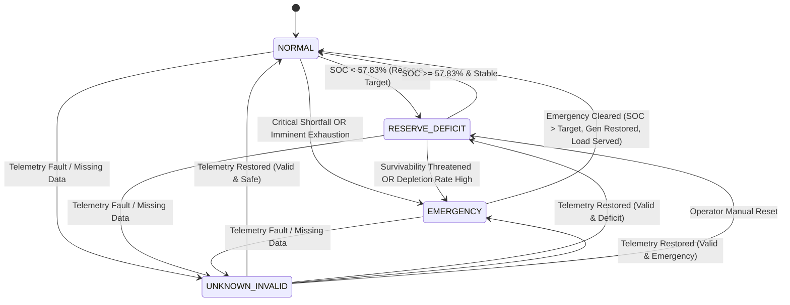

# POLARIS — EMERGENCY STATE MACHINE SPECIFICATION

## 1. Executive Summary & Purpose

This document specifies the conceptual state machine architecture for POLARIS Energy Management System (EMS) governance. It establishes clear, observable, and deterministic state transitions between normal economic operation, battery reserve recovery, governed emergency load shedding, and sensor/telemetry fault handling.

A core principle of this specification is the strict separation between:
- **State Determination (Entry/Exit Criteria)**: Observing station telemetry and system status to classify operational state.
- **State Action / Response**: The governed control actions taken once inside a state (e.g., Option C load hierarchy curtailment during Emergency Mode).

---

## 2. Four-State Taxonomy

The system defines four mutually exclusive operational states:

### 1. `NORMAL`
- **Definition**: Microgrid operates with full critical and non-critical load service. Battery SOC is at or above the 6-hour critical reserve target ($75.65\text{ kWh}$ / $57.83\%\text{ SOC}$).
- **Objective**: Economic dispatch, fuel minimization, max utilization of renewables, maintaining critical reserve.

### 2. `RESERVE DEFICIT / RECOVERY`
- **Definition**: Microgrid operates with full critical load service, but battery SOC has dropped below the 6-hour reserve target ($SOC < 57.83\%$).
- **Key Requirement**: **This state is NOT Emergency.** Battery energy is explicitly permitted to be drawn below the reserve target during normal operational variations.
- **Objective**: Maintain critical load service, prioritize battery replenishment when diesel or excess renewables are available, avoid unnecessary load curtailment.

### 3. `EMERGENCY`
- **Definition**: Governed emergency state triggered when evidence establishes that normal operation can no longer safely maintain the 6-hour critical load survivability requirement ($75.65\text{ kWh}$ / $11.6\text{ kW} \times 6\text{ h} / 0.92$).
- **Objective**: Protect critical-load survivability above all else. Apply Option C load hierarchy to curtail non-critical and flexible loads ($P_{\text{flex}}$).

### 4. `UNKNOWN / INVALID`
- **Definition**: Telemetry, communication, or sensor data is missing, stale, out-of-bounds, or unverified.
- **Governance Requirement**: **`UNKNOWN_INVALID != EMERGENCY`**. Missing or invalid data must **NEVER** automatically trigger Emergency Mode load shedding.
- **Objective**: Freeze or revert to conservative safe-harbor dispatch (e.g., maintain last known valid dispatch or run primary diesel generator), halt automatic optimization, issue immediate operator alarm, and await manual intervention or data restoration.

---

## 3. Conceptual State Diagram

---

## 4. State Transition Rules Matrix

| Current State | Target State | Trigger / Entry Condition | Verification & Persistence | Exit Action / Result |
| :--- | :--- | :--- | :--- | :--- |
| `NORMAL` | `RESERVE DEFICIT` | $SOC < 57.83\%$ ($E_{\text{batt}} < 75.65\text{ kWh}$) | Immediate on valid telemetry | Enable reserve recovery economic penalty; maintain full load service. |
| `RESERVE DEFICIT` | `NORMAL` | $SOC \ge 57.83\%$ ($E_{\text{batt}} \ge 75.65\text{ kWh}$) | Persisted for $M$ consecutive intervals (e.g., $M \ge 2$) | Clear reserve deficit indicator; resume normal dispatch balance. |
| `NORMAL` / `RESERVE DEFICIT` | `EMERGENCY` | **Hard Trigger**: $P_{\text{critical, served}} < P_{\text{critical, req}}$ **OR Imminent Exhaustion**: Net energy insufficient for 6h critical load | Governed persistence $N$ intervals (or immediate for hard physical failure) | Activate Option C load shedding hierarchy; prioritize critical buses. |
| `EMERGENCY` | `NORMAL` | Critical load 100% served **AND** $SOC \ge 57.83\%$ **AND** dispatchable generation available | Persisted for $P$ intervals with operator notification | Restore non-critical/flexible loads under governed ramp rates. |
| `ANY STATE` | `UNKNOWN / INVALID` | Telemetry missing, stale $> 30\text{ s}$, corrupt, or unphysical | Immediate on failure detection | Suspend MILP optimization; lock safe dispatch; notify operator. |
| `UNKNOWN / INVALID` | `PREVIOUS / VALID` | Valid telemetry restored **OR** explicit authorized operator override | Mandatory telemetry validity check pass | Resume automatic EMS control in evaluated state. |

---

## 5. Detailed State Definitions & Entry/Exit Protocols

### 5.1 NORMAL Mode
- **Preconditions**: All sensors healthy, battery $SOC \ge 57.83\%$, all loads served.
- **Allowed Dispatch Actions**: Economic dispatch, battery charging/discharging, renewable integration, generator start/stop optimization.
- **Transition Out**:
  - To `RESERVE DEFICIT`: When battery energy falls below $75.65\text{ kWh}$.
  - To `EMERGENCY`: Sudden generator fault + battery low, or critical load trip.
  - To `UNKNOWN / INVALID`: Loss of sensor communications or bad checksums.

### 5.2 RESERVE DEFICIT / RECOVERY Mode
- **Preconditions**: All sensors healthy, $SOC < 57.83\%$, critical load 100% served.
- **Allowed Dispatch Actions**: Normal economic dispatch with added soft objective penalty to encourage battery replenishment when cost-effective. **No automatic load shedding allowed.**
- **Transition Out**:
  - To `NORMAL`: Battery SOC restored to $\ge 57.83\%$.
  - To `EMERGENCY`: Depletion continues down to physical minimum (20% SOC) or generation capability fails.
  - To `UNKNOWN / INVALID`: Loss of sensor communication.

### 5.3 EMERGENCY Mode
- **Preconditions**: Triggered by critical load shortfall, battery depletion to physical minimum, or compound generation loss threatening critical survivability.
- **Allowed Dispatch Actions**: Option C governed load shedding hierarchy:
  1. Maintain 100% power to critical loads ($11.6\text{ kW}$).
  2. Curtail flexible/non-critical loads ($P_{\text{flex}}$) as required by available capacity.
  3. Force-start available dispatchable generation (diesel).
- **Transition Out**:
  - To `NORMAL`: Requires clear evidence of stable generation, critical load service, and battery SOC recovery above reserve target. Subject to operator notification and override.

### 5.4 UNKNOWN / INVALID State Governance
- **Data Integrity Requirements**: Telemetry must pass:
  1. Bounds check ($20\% \le SOC \le 95\%$, $P \ge 0$).
  2. Timeliness check (timestamp within 30 seconds of wall clock).
  3. Consistency check ($\sum P_{\text{gen}} = \sum P_{\text{load}} + P_{\text{batt\_charge}}$ within tolerance).
- **Action on Telemetry Failure**:
  - **DO NOT ENTER EMERGENCY MODE.**
  - Freeze output commands at safe levels or start backup diesel generator at nominal setpoint.
  - Log fault with cryptographic timestamp.
  - Signal high-priority operator alert.

---

## 6. Summary of Governance Alignment

This state machine strictly obeys all human governance decisions:
1. Reserve target ($75.65\text{ kWh}$) is an operational target, not a hard floor.
2. Reserve deficit is explicitly isolated from Emergency Mode.
3. Telemetry corruption does not cause false Emergency load shedding.
4. Entry conditions are purely observable and deterministic.
