# POLARIS — FORMAL EMERGENCY STATE MACHINE SPECIFICATION

## 1. Mathematical State Machine Formalism

The POLARIS Emergency Controller Dispatcher (ECD) state machine is formally defined as a 6-tuple:

$$M = (S, \Sigma, \delta, s_0, F, \Gamma)$$

Where:
- $S = \{\text{NORMAL}, \text{RESERVE\_DEFICIT}, \text{EMERGENCY}, \text{UNKNOWN\_INVALID}\}$ is the finite set of operational states.
- $\Sigma$ is the set of observable telemetry and system event inputs.
- $\delta: S \times \Sigma \rightarrow S$ is the deterministic state transition function.
- $s_0 = \text{NORMAL}$ (or evaluated initial state upon validated cold start) is the initial state.
- $F \subset S$ is the set of stable operating states.
- $\Gamma: S \rightarrow A$ maps states to allowable control action sets (e.g., MILP optimization, Option C load shedding, safe-harbor lock).

---

## 2. State Definitions & Operational Boundaries

```
+-----------------------------------------------------------------------------------+
|                                   S1: NORMAL                                      |
| - Condition: SOC >= 37.83% (E_batt >= 75.65 kWh) AND All telemetry valid          |
| - Load Service: 100% Critical (11.6 kW) + 100% Flexible (P_flex)                  |
| - Optimization: Full economic MILP active (fuel minimization, renewable max)       |
+-----------------------------------------------------------------------------------+
                                          |
                                          | T_12: SOC < 37.83% AND M_surv >= 0
                                          v
+-----------------------------------------------------------------------------------+
|                             S2: RESERVE_DEFICIT / RECOVERY                        |
| - Condition: SOC < 37.83% (E_batt < 75.65 kWh) AND M_surv >= 0                    |
| - Load Service: 100% Critical (11.6 kW) + 100% Flexible (P_flex)                  |
| - Optimization: Economic MILP with reserve replenishment penalty                  |
| - CRITICAL GOVERNANCE: LOAD SHEDDING PROHIBITED (Not an Emergency)                 |
+-----------------------------------------------------------------------------------+
                                          |
                                          | T_23: M_surv < 0 OR P_critical_served < P_req
                                          v
+-----------------------------------------------------------------------------------+
|                                 S3: EMERGENCY                                     |
| - Condition: Validated P_critical failure OR Imminent Survivability Deficit (M_surv < 0)
| - Load Service: 100% Critical (11.6 kW) PROTECTED; Flexible (P_flex) CURTAILED    |
| - Optimization: Option C Governed Hierarchy MILP (No zero-dispatch)               |
+-----------------------------------------------------------------------------------+
                                          |
                                          | Any Telemetry Fault / Bad Checksum
                                          v
+-----------------------------------------------------------------------------------+
|                              S4: UNKNOWN_INVALID                                  |
| - Condition: Missing, stale (>30s), corrupt, or out-of-bounds telemetry           |
| - Load Service: Safe-harbor dispatch (Primary diesel locked; Critical served)     |
| - Optimization: HALTED (Automatic optimization suspended)                         |
| - CRITICAL GOVERNANCE: UNKNOWN_INVALID != EMERGENCY (No false load shedding)       |
+-----------------------------------------------------------------------------------+
```

---

## 3. Telemetry Validation Sub-system ($\text{V}_{\text{telemetry}}$)

Before state evaluation, input vector $\mathbf{x}(t)$ is processed through the Telemetry Validation Sub-system $\text{V}_{\text{telemetry}}(\mathbf{x}(t)) \in \{\text{VALID}, \text{INVALID}\}$.

### 3.1 Validation Criteria
A telemetry snapshot $\mathbf{x}(t) = (SOC, P_{\text{crit\_req}}, P_{\text{crit\_srv}}, P_{\text{diesel}}, P_{\text{ren}}, \Delta t)$ is **VALID** if and only if all of the following hold:
1. **Freshness Guard**: $\Delta t = t_{\text{wall}} - t_{\text{sample}} \le 30.0\text{ seconds}$.
2. **SOC Range Guard**: $20.0\% \le SOC(t) \le 95.0\%$.
3. **Power Telemetry Bounds**: $P_{\text{crit\_srv}} \ge 0$, $P_{\text{diesel}} \ge 0$, $P_{\text{ren}} \ge 0$.
4. **Physical Bus Consistency**: $\left| P_{\text{generation}} - P_{\text{load}} - P_{\text{battery}} \right| \le \epsilon_{\text{bus}}$ (where $\epsilon_{\text{bus}} = 0.5\text{ kW}$).

If any validation check fails:
$$\text{V}_{\text{telemetry}}(\mathbf{x}(t)) = \text{INVALID} \implies \delta(S_{\text{current}}, \mathbf{x}(t)) = \text{UNKNOWN\_INVALID}$$

---

## 4. Formal Transition Function & Guard Conditions

Let $M_{\text{surv}}(t)$ be the **Critical Load Survivability Margin**:

$$M_{\text{surv}}(t) = E_{\text{batt, usable}}(t) + E_{\text{gen, credible}}(t, 6\text{h}) + E_{\text{ren, credible}}(t, 6\text{h}) - E_{\text{critical, req}}(6\text{h})$$

Where $E_{\text{critical, req}}(6\text{h}) = 75.652\text{ kWh}$.

### 4.1 Transition Table

| Transition ID | From State | To State | Guard Condition (Mathematical Logic) | Action / Result |
| :--- | :--- | :--- | :--- | :--- |
| **$T_{12}$** | `NORMAL` | `RESERVE_DEFICIT` | $\text{V} = \text{VALID} \land SOC(t) < 37.83\% \land M_{\text{surv}}(t) \ge 0 \land P_{\text{crit\_srv}} = P_{\text{req}}$ | Enter Reserve Recovery; maintain 100% load. |
| **$T_{21}$** | `RESERVE_DEFICIT` | `NORMAL` | $\text{V} = \text{VALID} \land SOC(t) \ge 37.83\% \land P_{\text{crit\_srv}} = P_{\text{req}}$ | Clear Reserve Deficit indicator; resume normal dispatch. |
| **$T_{13}$** | `NORMAL` | `EMERGENCY` | $\text{V} = \text{VALID} \land (P_{\text{crit\_srv}} < P_{\text{req}} \lor M_{\text{surv}}(t) < 0)$ | Activate Emergency Mode; enforce Option C shedding. |
| **$T_{23}$** | `RESERVE_DEFICIT` | `EMERGENCY` | $\text{V} = \text{VALID} \land (P_{\text{crit\_srv}} < P_{\text{req}} \lor M_{\text{surv}}(t) < 0)$ | Activate Emergency Mode; enforce Option C shedding. |
| **$T_{31}$** | `EMERGENCY` | `NORMAL` | $\text{V} = \text{VALID} \land P_{\text{crit\_srv}} = P_{\text{req}} \land M_{\text{surv}}(t) \ge 0 \land SOC(t) \ge 37.83\% \land \text{Gen\_OK}$ | Clear Emergency Mode; restore flexible load under ramp control; notify operator. |
| **$T_{x4}$** | `ANY STATE` | `UNKNOWN_INVALID` | $\text{V}_{\text{telemetry}}(\mathbf{x}(t)) = \text{INVALID}$ | Suspend automatic optimization; lock safe-harbor dispatch; alert operator. |
| **$T_{4x}$** | `UNKNOWN_INVALID` | `EVALUATED STATE` | $\text{V}_{\text{telemetry}}(\mathbf{x}(t)) = \text{VALID} \lor \text{Operator\_Override} = \text{TRUE}$ | Resume automatic state evaluation; transition to evaluated valid state. |

---

## 5. Formal State Diagram (Mermaid)

```mermaid
stateDiagram-v2
    [*] --> NORMAL : System Boot / Telemetry Valid

    state NORMAL {
        [*] --> Normal_Operating
        Normal_Operating : Full Critical & Flexible Load Served
        Normal_Operating : SOC >= 37.83% (75.65 kWh)
    }

    state RESERVE_DEFICIT {
        [*] --> Deficit_Operating
        Deficit_Operating : Full Load Served (No Curtailment)
        Deficit_Operating : SOC < 37.83%, Survivability Secure (M_surv >= 0)
    }

    state EMERGENCY {
        [*] --> Option_C_Execution
        Option_C_Execution : Critical Load (11.6 kW) Protected
        Option_C_Execution : Flexible Load (P_flex) Curtailed
    }

    state UNKNOWN_INVALID {
        [*] --> Safe_Harbor_Lock
        Safe_Harbor_Lock : Telemetry Missing / Corrupt
        Safe_Harbor_Lock : Optimization Suspended; Diesel Locked
    }

    NORMAL --> RESERVE_DEFICIT : T_12 (SOC < 37.83% & M_surv >= 0)
    RESERVE_DEFICIT --> NORMAL : T_21 (SOC >= 37.83%)

    NORMAL --> EMERGENCY : T_13 (P_crit Failure OR M_surv < 0)
    RESERVE_DEFICIT --> EMERGENCY : T_23 (P_crit Failure OR M_surv < 0)

    EMERGENCY --> NORMAL : T_31 (P_crit OK & M_surv >= 0 & SOC >= 37.83% & Gen OK)

    NORMAL --> UNKNOWN_INVALID : Telemetry Invalid
    RESERVE_DEFICIT --> UNKNOWN_INVALID : Telemetry Invalid
    EMERGENCY --> UNKNOWN_INVALID : Telemetry Invalid

    UNKNOWN_INVALID --> NORMAL : Telemetry Restored (Valid & SOC >= 37.83%)
    UNKNOWN_INVALID --> RESERVE_DEFICIT : Telemetry Restored (Valid & SOC < 37.83%)
    UNKNOWN_INVALID --> EMERGENCY : Telemetry Restored (Valid & Emergency Cond)
```



---

## 6. Execution & Governance Guarantees

1. **Deterministic Execution**: The state transition function $\delta(S, \mathbf{x})$ is single-valued and deterministic for every valid input tuple.
2. **False Shedding Lockout**: Under no circumstance can `UNKNOWN_INVALID` transition directly to `EMERGENCY`. Load shedding is strictly forbidden on sensor loss.
3. **No Hidden Thresholds**: The $37.83\%\text{ SOC}$ target ($75.65\text{ kWh}$) triggers `RESERVE_DEFICIT`, never `EMERGENCY`. $57.83\%$ is permanently decommissioned as an emergency boundary.
