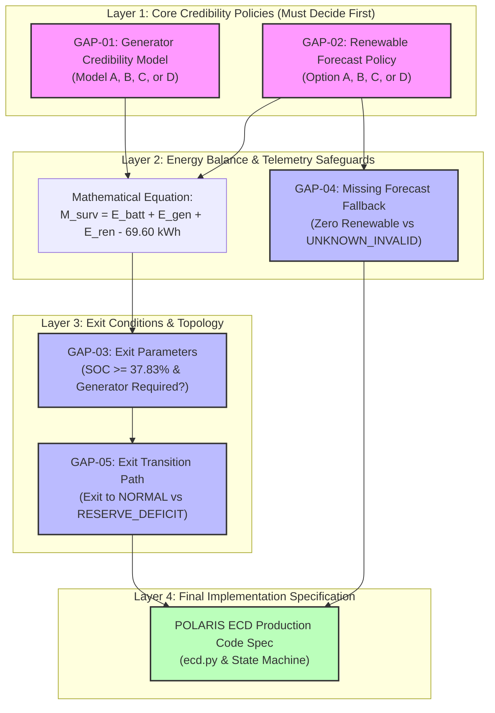

# POLARIS — EMERGENCY TRIGGER GAP DEPENDENCY GRAPH

## Executive Overview

This artifact documents the **inter-gap dependencies and decision precedence topology** for resolving the remaining POLARIS Emergency Governance gaps. 

Resolving human governance decisions in the correct logical sequence prevents contradictory specification rules and ensures mathematical consistency.

---

## 1. Cross-Gap Interaction Analysis

```
+-----------------------------------------------------------------------------------+
|                           1. GENERATOR <-> RENEWABLE                              |
| GAP-01 (Gen Credibility) and GAP-02 (Renewable Derating) jointly determine total   |
| net deliverable energy. If renewables receive zero credit (GAP-02 Option C),       |
| generator credibility (GAP-01) becomes the sole determinant of 6h survivability.  |
+-----------------------------------------------------------------------------------+

+-----------------------------------------------------------------------------------+
|                        2. SURVIVABILITY MARGIN <-> EXIT                           |
| GAP-01/02 establish M_surv math. GAP-03 (Exit Criteria) and GAP-05 (Exit Path)    |
| evaluate M_surv for state transitions. M_surv math MUST be locked before exit    |
| thresholds (+10 kWh or 4-interval persistence) can be finalized.                 |
+-----------------------------------------------------------------------------------+

+-----------------------------------------------------------------------------------+
|                        3. RESERVE TARGET <-> EXIT PATH                            |
| GAP-05 (Exit to Deficit vs Normal) depends on whether SOC >= 37.83% is a          |
| mandatory exit condition (GAP-03). If exit requires SOC >= 37.83%, exit to        |
| RESERVE_DEFICIT is impossible because SOC is already at reserve target.           |
+-----------------------------------------------------------------------------------+

+-----------------------------------------------------------------------------------+
|                     4. UNKNOWN_INVALID <-> FORECAST FALLBACK                      |
| GAP-04 (Missing Forecast Fallback) dictates whether missing weather telemetry     |
| triggers UNKNOWN_INVALID (sensor lock) or sets E_ren = 0.0 (fail-safe fallback).   |
+-----------------------------------------------------------------------------------+
```

---

## 2. Decision Precedence Dependency Graph (Mermaid)



---

## 3. Recommended Order of Decision Sign-Off

To ensure systematic resolution, the human project owner should resolve decisions in the following sequence:

1. **FIRST**: Resolve **GAP-01** (Generator Credibility Model) and **GAP-02** (Renewable Forecast Policy). This locks the input terms of the $M_{\text{surv}}$ equation.
2. **SECOND**: Resolve **GAP-04** (Missing Forecast Fallback). This defines system behavior when weather telemetry drops out.
3. **THIRD**: Resolve **GAP-03** (Emergency Exit Requirements) and **GAP-05** (Exit Transition Topology). This defines state transition mechanics.
4. **FOURTH**: Authorize ECD production code implementation based on the fully locked specification.
